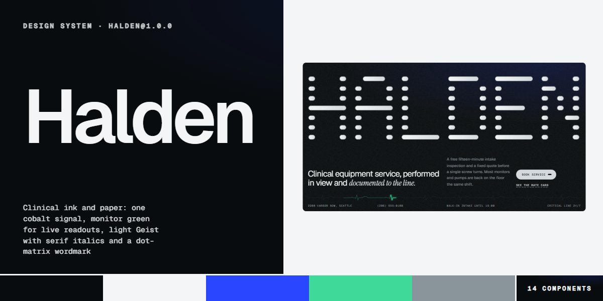

# Halden · design system

`halden@1.0.0` · 14 components · 45 tokens · light

A calm, precise clinical language for healthcare, medical, regulated and professional services: sections alternate grained ink and cool paper, one cobalt accent marks the thing that matters, monitor green appears only on live readouts and the ECG trace, Geist is set light and large with Instrument Serif italic accents, and every label is Geist Mono caps. The HALDEN wordmark is drawn from pill rows on a dot-matrix grid; check boards, rate cards and route boards read like instruments. Extracted from the Halden Clinical Equipment page.

The full board, every component at once: [preview.jpg](preview.jpg)

**Explore it live:** [instalanding.ai/systems/halden](https://instalanding.ai/systems/halden) — every component rendered, a token playground and COPY FOR AGENT.

## Files

| File | What it is |
| --- | --- |
| [`specimen.html`](specimen.html) | Every component live in one file. Each is a `<section data-component>`; the markup inside `.sp-demo` is the component. Opens from disk. |
| [`tokens.css`](tokens.css) | The design tokens as CSS custom properties (`--hd-*`). |
| [`halden.css`](halden.css) | Tokens plus every component's CSS, scoped under `.hd` with `hd-` class names, so it can't restyle anything else on your page. |

## Use it

1. Load the fonts: `<link rel="stylesheet" href="https://fonts.googleapis.com/css2?family=Geist:wght@300..600&family=Geist+Mono:wght@400;500&family=Instrument+Serif:ital@0;1&display=swap">`
2. Link `halden.css` and wrap the part of your page that uses the system in `
`.
3. Copy components from `specimen.html`. Interactive ones need the small script in its `<script id="hd-components-js">`, and any that draw SVG art need its `<svg id="hd-defs">`.
4. Change the look by editing the tokens, not the components.

## Components

- Navigation
- Buttons & links
- Dot-matrix hero
- Live readout strip
- Diagnosis board
- Rate card
- Bench strips
- Device shelf
- Route board
- Process steps
- Review quotes
- FAQ
- Booking form
- Footer

## Conventions

**Typography**

- Display is Geist 300 (.hd-text-2, --hd-display) with letter-spacing -.05em and line-height .92; big titles break into words staggered across the column grid. Exactly one phrase per title turns to Instrument Serif italic (.hd-serif) in --hd-steel on ink or --hd-slate on paper.
- Titles and quotes are Geist 300-350 (.hd-text-4, --hd-title, --hd-quote); body is Geist at --hd-body with line-height 1.6. Figures and row names use .hd-text-5 (Geist 450, tabular numbers).
- Every label, kicker, caption, button and spec line is Geist Mono uppercase: .hd-text-3 at --hd-caps (.08em tracking) and .hd-spread at --hd-spread, which justifies a kicker across the full width.

**Color**

- Sections alternate .hd-surface (ink #090C0E with --hd-grain, text --hd-mist) and .hd-surface-2 (paper #F3F5F6, text --hd-ink). Rules are 1px --hd-graphite on ink and --hd-frost on paper.
- Cobalt (--hd-cobalt) is the only accent: the button wipe, the scan band, fault dashes, time bars, the route cursor, the highlight (.hd-select) and focus rings. Never two cobalt things competing in one view.
- Monitor green (--hd-monitor) is reserved for live readouts: the ECG trace (.hd-op-ecg), the pulsing status dot and on-screen vital signs. Never on buttons, links or decoration.

**Layout & shapes**

- Content sits on a four-column grid (.hd-grid, column gap --hd-gutter) that drops to two columns under 48em; sections pad with --hd-section on a page (--hd-block for a compact component) and open with a .hd-spread kicker.
- The pill is the signature shape: buttons, the trailing dash in every button (.hd-dash), step bars, time bars, route windows, FAQ toggles and the wordmark's dots all use --hd-r-pill. Boards and cards use --hd-r-lg / --hd-r-md with a hairline, not shadows; the white form card is the one raised surface (--hd-shadow-form).
- Data reads like an instrument: real tables with captions for rates, a check board with name left and dashed result right, route windows positioned by --hd-a / --hd-b (hours 08-18), time bars sized by --hd-m (minutes of 180). The wordmark is pill rows on a 5 x 7 grid per letter sized by --hd-u: change letters by editing the spans.

**Motion**

- Hover is a cobalt wipe from the left on --hd-ease over --hd-dur, with the button's dash stretching; links' dashed underline flows over --hd-dur-flow.
- Instruments move on their own, slowly: the wordmark rows pulse in turn (--hd-dur-pulse), the ECG head sweeps (--hd-dur-ecg), the status dot pings (--hd-dur-live), the scan band walks the checks, the route cursor sweeps the day and a cobalt box reads review quotes word by word. Loops run only while on screen.
- With prefers-reduced-motion everything is static and complete: every check result, every route window and the summary are shown.

**Accessibility**

- Decorative pills, dashes, the scan band, the cursor and the ECG are aria-hidden; pictures are inline SVG with role="img" and an aria-label; rate and comparison data are real tables with captions and scoped headers.
- The menu button carries aria-expanded and the open panel focuses its close button; Escape closes it. The FAQ is native details/summary.
- Fields are wrapped in their labels; the status line is role="status" and turns cobalt on an error. Focus is a 2px outline offset 3-4px, cobalt on fields and buttons.

## Extracted from

- [Halden Clinical Equipment Page](../../pages/halden-clinical-equipment-page) · [live](https://instalanding.ai/demos/halden-clinical.html)

Every system is extracted from a real, working page: the components are its markup, not a redraw.

MIT.
