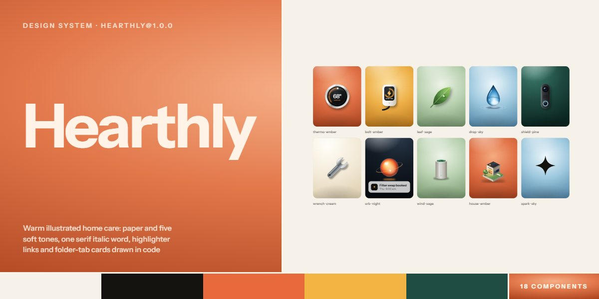

# Hearthly · design system

`hearthly@1.0.0` · 18 components · 54 tokens · light

A friendly, illustrated language for consumer AI, home services, health and family products: warm paper and ink with five soft tones (ember, sage, amber, sky, pine), Instrument Sans headings with one Instrument Serif italic word, links and signatures marked with a highlighter band, and pill buttons that wash amber from below. Cards take a folder-tab notch on a top corner; pictures are gradient plates with lit icons from one inline SVG sprite (an isometric house, a thermostat, a water drop, a charger, a shield, the AI orb), plus a full night scene and illustrated portraits. Stacking service folders, arched system plates, an assistant chat, a tilted phone and a dark pine footer complete it. Extracted from the Hearthly AI Home Care page.

The full board, every component at once: [preview.jpg](preview.jpg)

**Explore it live:** [instalanding.ai/systems/hearthly](https://instalanding.ai/systems/hearthly) — every component rendered, a token playground and COPY FOR AGENT.

## Files

| File | What it is |
| --- | --- |
| [`specimen.html`](specimen.html) | Every component live in one file. Each is a `<section data-component>`; the markup inside `.sp-demo` is the component. Opens from disk. |
| [`tokens.css`](tokens.css) | The design tokens as CSS custom properties (`--hy-*`). |
| [`hearthly.css`](hearthly.css) | Tokens plus every component's CSS, scoped under `.hy` with `hy-` class names, so it can't restyle anything else on your page. |

## Use it

1. Load the fonts: `<link rel="stylesheet" href="https://fonts.googleapis.com/css2?family=Instrument+Sans:wght@400..700&family=Instrument+Serif:ital@0;1&display=swap">`
2. Link `hearthly.css` and wrap the part of your page that uses the system in `
`.
3. Copy components from `specimen.html`. Interactive ones need the small script in its `<script id="hy-components-js">`, and any that draw SVG art need its `<svg id="hy-defs">`.
4. Change the look by editing the tokens, not the components.

## Components

- Header
- Buttons & links
- Headings & highlighter
- Illustrated plates
- Hero collage
- Night scene
- Quote & feature
- Service folders
- System plates
- Room gallery
- Assistant chat & steps
- Figures & bars
- Team portraits
- Quote & reviews
- Plans
- FAQ
- App panel
- Footer

## Conventions

**Typography**

- One sans: Instrument Sans. Headings are 700 with tight tracking (-.035em to -.05em): .hy-h2 at --hy-h2, the gallery title at --hy-display, the contact title at --hy-title. Big figures, prices and numerals are weight 400 with -.06em tracking for contrast.
- One word or phrase per heading is <em class="hy-s">, set in Instrument Serif italic. Signatures (.hy-sign) use the same serif italic on a highlighter band.
- Leads are --hy-lead in --hy-muted, max 34em. Eyebrows are 12px, 600, uppercase, +.14em, with an ember dot in a soft halo.

**Color**

- Warm paper (--hy-bg) and ink, with --hy-soft for cards and bands and --hy-line for rules; muted text, lines and soft are color-mix derivatives, so editing the core recolours them.
- Five tones carry cards, folders, plates and bars: ember, sky, sage, amber and pine (.hy-tone-1 to .hy-tone-5 set --hy-plate; pine flips the text to paper). Amber is the hover wash and the dark plan's accent; ember marks eyebrows, stars and step dots.
- The highlighter (--hy-marker) replaces underlines: links sweep it in on hover, signatures and the contact email sit on it. The footer is pine-black (--hy-night) with an amber glow; green (--hy-live, --hy-ok) only means live.

**Shapes & pictures**

- Cards use --hy-r; tall cards take a folder-tab notch on one top corner (.hy-tab-l, .hy-tab-r, drawn with clip-path shape() and falling back to plain radii). Folders have a real tab with inverted corners; the chosen plan has one too.
- Pictures are .hy-art plates: a .hy-g-* gradient (ember, amber, sage, sky, pine, cream, night) with a top light, floor shadow, vignette and grain, holding one <svg class="hy-ico"><use href="#hy-s-…"/></svg> from the shared sprite in <svg id="hy-defs">. Each gradient sets the icon's inks.
- Buttons are pills (.hy-btn ink, .hy-btn--line outline, .hy-btn--sm); icon buttons (.hy-ibtn) are rings. Frosted status chips and UI cards sit on plates with --hy-glass.

**Motion**

- Everything eases on --hy-ease (cubic-bezier(.2,.75,.15,1)). Buttons wash from the bottom over --hy-dur-wash and their arrow nudges up-right; ring buttons fill from the centre; links sweep the marker in over --hy-dur-fill.
- Ambient loops are slow and small: hero cards float out of phase, the text ring and burst spin, sensor rings pulse, typing dots blink and the live status breathes. The hero's loops pause when it leaves the screen; the review row loops at 55px/s while visible and pauses on hover or focus.
- With prefers-reduced-motion every loop and transition stops and the reviews wrap; every component is complete without motion.

**Accessibility**

- Meaningful plates carry role="img" and an aria-label; icons and decorative SVG are aria-hidden. The marquee's copies are aria-hidden with their links out of the tab order.
- The burger has aria-controls, aria-expanded and a label that swaps between open and close; the billing toggle is a labelled group with aria-pressed; FAQ rows are native details and summary.
- Focus is a 2px ember outline offset 3px. Body text stays at --hy-ink or --hy-muted on paper and soft; tone plates keep ink text except pine, which switches to paper.

## Extracted from

- [Hearthly AI Home Care Page](../../pages/hearthly-ai-home-care-page) · [live](https://instalanding.ai/demos/hearthly-home-care.html)

Every system is extracted from a real, working page: the components are its markup, not a redraw.

MIT.
