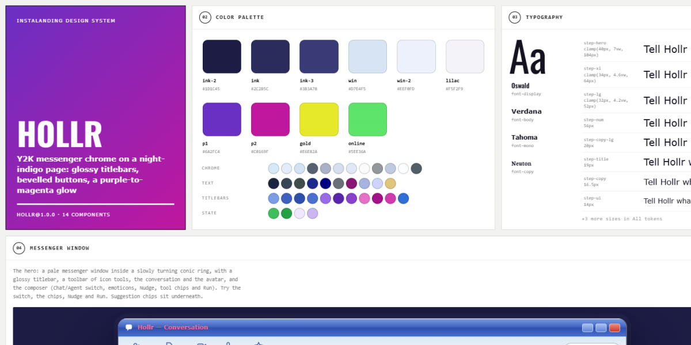

# Hollr · design system

`hollr@1.0.0` · 14 components · 88 tokens · dark

A dark retro desktop: night-indigo pages, pale messenger windows with glossy two-tone titlebars inside slowly turning conic rings, bevelled classic buttons beside a purple → magenta brand button with a gold edge, buddy lists, help chats and agent checklists. Oswald display, Neuton copy, Verdana and Tahoma for the UI. Extracted from the Retro Messenger Agent Page.

**Explore it live:** [instalanding.ai/systems/hollr](https://instalanding.ai/systems/hollr) — every component rendered, a token playground and COPY FOR AGENT.

## Files

| File | What it is |
| --- | --- |
| [`specimen.html`](specimen.html) | Every component live in one file. Each is a `<section data-component>`; the markup inside `.sp-demo` is the component. Opens from disk. |
| [`tokens.css`](tokens.css) | The design tokens as CSS custom properties (`--hl-*`). |
| [`hollr.css`](hollr.css) | Tokens plus every component's CSS, scoped under `.hl` with `hl-` class names, so it can't restyle anything else on your page. |

## Use it

1. Load the fonts: `<link rel="stylesheet" href="https://fonts.googleapis.com/css2?family=Oswald:wght@400;500;600;700&family=Neuton:ital,wght@0,400;0,700;1,400&display=swap">`
2. Link `hollr.css` and wrap the part of your page that uses the system in `
`.
3. Copy components from `specimen.html`. Interactive ones need the small script in its `<script id="hl-components-js">`, and any that draw SVG art need its `<svg id="hl-defs">`.
4. Change the look by editing the tokens, not the components.

## Components

- Navigation
- Buttons
- Status & badges
- Framed heading
- Messenger window
- Agent run
- Feature cards
- Step windows
- Search & ask
- Help chat
- Buddy list
- Sign-up panel
- Toast
- Footer

## Conventions

**Typography**

- Display is Oswald (--hl-font-display), bold and uppercase: framed headings use .hl-ait with an .hl-ait-kick (Neuton, letter-spacing .5em) over an .hl-ait-big line filled with a moving pastel-to-gold gradient, on --hl-step-hero / --hl-step-xl.
- Descriptive copy (ledes, card text, answers) is Neuton (--hl-font-copy) at --hl-step-copy-lg / --hl-step-copy; UI text inside windows is Verdana (--hl-font-body) at 11-14px, and buttons are bold Tahoma (--hl-font-mono).
- Kickers and column heads are 11px uppercase, letter-spaced 2px, in --hl-tab gold-tan (.hl-eyebrow).

**Layout**

- The page is dark (--hl-ink-2 → --hl-ink); content lives in pale windows (--hl-win-top → --hl-win-bottom) with 1px --hl-line borders. Never put body text straight on the night background except ledes and kickers.
- Width is .hl-wrap (--hl-page-max 1200px, --hl-gutter 20px); sections sit --hl-section-y apart. Feature grids go 3 → 2 → 1 at 980px and 680px; the messenger window drops its avatar column under 680px.
- Panes inside a window are separated by --hl-pane-gap with white inner panels (radius --hl-radius-md) on the chrome.

**Windows & chrome**

- Every window has a glossy two-tone titlebar (.hl-titlebar: --hl-blue-hi → --hl-blue / --hl-blue-lo → --hl-blue-end, a hard stop at 48/52%) with a title, three .hl-ctl buttons (the last red) and a sheen sweeping across. Violet (agent, help) and rose titlebars use the --hl-violet-* / --hl-rose-* stops.
- Hero windows sit in an .hl-ring: a --hl-border-ring conic border in magenta, gold and purple turning on --hl-dur-ring, with --hl-shadow-window. Toolbars and card bars are the lilac --hl-bar-a → --hl-lilac → --hl-bar-a gradient; status strips are --hl-status with --hl-status-ink bold text.
- Two button families only: the brand .hl-btn-prime (--hl-p1 → --hl-p2, gold edge, glass top half, sheen, --hl-glow-prime) and the classic bevel (--hl-face, --hl-edge border, --hl-shadow-bevel) for everything secondary.

**Motion**

- Hover lifts by 1-2px on --hl-dur with --hl-ease; arrows step 4px right. Messages fade up on --hl-dur-msg; checkmarks, step numbers and picks pop on --hl-ease-spring.
- Ambient motion is slow and constant: ring rotation (--hl-dur-ring), sheens (--hl-dur-sheen), floating 3D icons, pinging online dots, typing dots.
- Nudge shakes the window (.hl-shake, twice). Under prefers-reduced-motion every animation and transition collapses to its end state.

**Accessibility**

- The Chat/Agent switch is a radiogroup with aria-checked; tool chips are toggle buttons with aria-pressed; help-chat questions are buttons with aria-expanded controlling a role=region answer.
- Focus is a 2px --hl-gold outline offset 3px on links, buttons and summaries.
- Decorative chrome (titlebar controls, avatars, stickers, wordmark) is aria-hidden; status text in a window's statusbar stays readable at --hl-status-ink on --hl-status.

## Extracted from

- [Retro Messenger Agent Page](../../pages/retro-messenger-agent-page) · [live](https://instalanding.ai/demos/hollr-messenger.html)

Every system is extracted from a real, working page: the components are its markup, not a redraw.

MIT.
