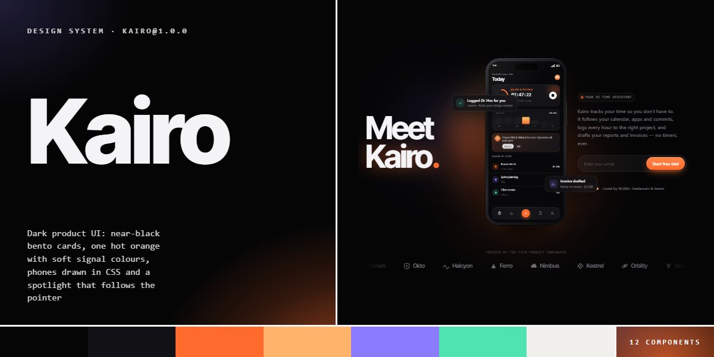

# Kairo · design system

`kairo@1.0.0` · 12 components · 67 tokens · dark

A dark product language for AI apps and dashboards: near-black cards on a masked 72px grid, one hot orange (with a peach partner) and four soft signal colours (violet, mint, sky, rose) that glow rather than fill, Inter Tight set tight and heavy, and JetBrains Mono labels in hairline pills with a pulsing dot. Bento cards carry live pictures drawn in code (a glowing day timeline, focus rings, synced devices, an area chart) and an orange spotlight that follows the pointer and lights their border. Phones are drawn in CSS with a working app screen that switches to light; app tiles orbit a phone, stats rise in gradient figures over thin bars, and the page closes on a warm paper sheet of white cards and a giant fading wordmark. Extracted from the Kairo AI Time Assistant page.

The full board, every component at once: [preview.jpg](preview.jpg)

**Explore it live:** [instalanding.ai/systems/kairo](https://instalanding.ai/systems/kairo) — every component rendered, a token playground and COPY FOR AGENT.

## Files

| File | What it is |
| --- | --- |
| [`specimen.html`](specimen.html) | Every component live in one file. Each is a `<section data-component>`; the markup inside `.sp-demo` is the component. Opens from disk. |
| [`tokens.css`](tokens.css) | The design tokens as CSS custom properties (`--kr-*`). |
| [`kairo.css`](kairo.css) | Tokens plus every component's CSS, scoped under `.kr` with `kr-` class names, so it can't restyle anything else on your page. |

## Use it

1. Load the fonts: `<link rel="stylesheet" href="https://fonts.googleapis.com/css2?family=Inter:wght@400;500;600&family=Inter+Tight:wght@500;600;700;800&family=JetBrains+Mono:wght@500;600&display=swap">`
2. Link `kairo.css` and wrap the part of your page that uses the system in `
`.
3. Copy components from `specimen.html`. Interactive ones need the small script in its `<script id="kr-components-js">`, and any that draw SVG art need its `<svg id="kr-defs">`.
4. Change the look by editing the tokens, not the components.

## Components

- Navigation
- Buttons, chips & keys
- Headline & section head
- Hero with phone
- Phone app screen
- Spotlight bento
- Integration orbit
- Stats list
- Download & theme preview
- Light bento
- Closing panel
- Footer & wordmark

## Conventions

**Typography**

- Three families: Inter Tight (--kr-font-display) at 700 for every heading and figure, tracked tight (-.04em, the hero -.06em, figures -.05em) with line-height near 1; Inter (--kr-font-text) at 400-600 for text and buttons; JetBrains Mono (--kr-font-mono) at 500-600 for labels, tags, keys, times and timers.
- Labels are mono capitals at --kr-label with .08em tracking: section eyebrows sit in a hairline pill (.kr-eyebrow) with a pulsing orange dot; card tags (.kr-tag) are bare and peach (orange on the light sheet).
- Emphasis is the shine gradient (.kr-grad: white to peach to orange, sliding on --kr-shine), used for the last words of a title, never a whole heading. Big figures (.kr-stat-num) fade from white to grey; the hero's glowing line (.kr-glow, data-text set to its text) has a blurred orange copy behind it.

**Color & light**

- The ground is near-black (--kr-bg), never flat: a masked 72px grid (--kr-line) and blurred orange and violet orbs sit behind heroes. Cards step up to --kr-card / --kr-card2 with a --kr-line hairline; controls use --kr-line2.
- Orange (--kr-accent, --kr-accent2) is the one hot colour: primary pills, live dots, today's bar, the NOW line, spotlights and halos. Violet, mint, sky and rose are signals for categories, success and sync; they glow (box-shadow 0 0 18px -4px of the colour) or tint (14-18% mixes) rather than fill large areas.
- The light sheet (.kr-light-sec on --kr-paper, ink --kr-paper-ink) closes the page: white cards (.kr-lcard) with --kr-shadow-lift, and the deeper signal shades (--kr-mint-deep, --kr-sky-deep, --kr-rose-deep) so they read on white.

**Cards & pictures**

- Bentos are a 12-column grid (.kr-bento, --kr-gap) of cards spanning .kr-c-4 to .kr-c-8, all full width under 900px. A dark card is .kr-card (--kr-r-card, min-height 420px) with a .kr-card-viz picture and .kr-card-text; give it data-kr-spot for the pointer spotlight.
- Reveal-driven pictures (timeline bars, rings, the chart line, stat and team bars, logging rows) are drawn in their finished state under an ancestor with .kr-in; leave it off to animate them in with your own observer.
- Pictures are CSS and inline SVG, never image files: phones as .kr-phone (sized by --kr-pw, .kr-light for the light screen) holding the .kr-screen app markup, devices as .kr-dev, orbit tiles as .kr-tile with --kr-a and --kr-c. Radii step down by size: --kr-r-stage 40px, --kr-r-cta 36px, --kr-r-card 28px, --kr-r-panel 22px, --kr-r-tile 20px, --kr-r-chip 16px, and pills (--kr-pill) for buttons, tracks and tags.

**Motion**

- Everything eases on --kr-ease (cubic-bezier(.2,.7,.1,1)): buttons and badges lift 2-3px on hover over --kr-dur-quick, the theme knob slides over --kr-dur-knob, bars fill over --kr-dur-fill and rings over --kr-dur-ring.
- Ambient loops stay slow and small: the hero phone floats on --kr-float, its conic halo spins, orbit tiles go round on --kr-orbit while counter-rotating, the logo marquee runs on --kr-marquee and pauses on hover, live dots pulse, and a light sweep crosses the orange button.
- Under prefers-reduced-motion every animation and transition stops and every component shows its finished state; the component script also stops the theme stage, the AI line and the counters.

**Accessibility**

- The cart is a role="dialog" panel opened by a button with aria-haspopup; the menu button carries aria-expanded; Escape closes both. The theme switch is a labelled group of real buttons.
- Email forms (.kr-js-form) validate locally and report in the .kr-form-msg after them, which is aria-live; they send nothing.
- Decorative layers (orbs, grids, halos, ripples, the footer wordmark) are aria-hidden or pointer-events: none; muted text (--kr-muted) stays on --kr-bg or darker cards, never --kr-dim, which is for axis labels and placeholders only.

## Extracted from

- [Kairo AI Time Assistant Page](../../pages/kairo-ai-time-assistant-page) · [live](https://instalanding.ai/demos/kairo-time-assistant.html)

Every system is extracted from a real, working page: the components are its markup, not a redraw.

MIT.
