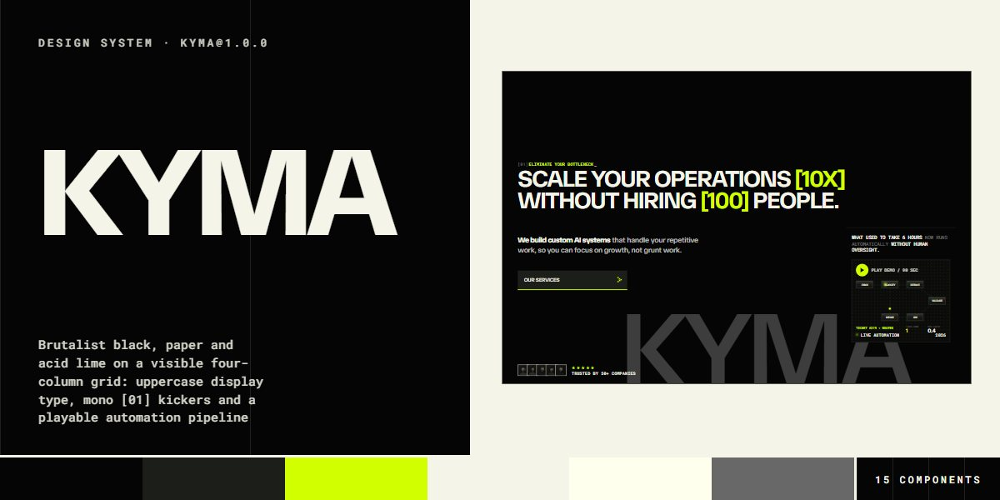

# KYMA · design system

`kyma@1.0.0` · 15 components · 59 tokens · dark

A brutalist agency language for AI automation studios, ops consultancies and technical services: black and paper sections laid on a fixed four-column grid of hairlines, TASA Orbiter set uppercase, heavy and tight, Roboto Mono for every label, [01] kicker and figure, and one acid lime spent on brackets, underlines, markers and the numbers that matter. Everything is square: buttons are panel-dark bars with a 2px lime underline that a lime fill wipes up through, switches and checkboxes are squares, and the header blends with mix-blend-mode: difference so it reads on both grounds. The signature pieces are working machines: a hero pipeline where packets ride glass nodes and a demo plays at 2.4x, pain chips that fly out of a sticky frame as you scroll, an ROI calculator with lime-filled sliders, an indexed services table, a six-week ruler with stair-stepped weeks, and pricing that eases to annual. Pictures (portraits, case art, article covers, a crystal) are SVG drawn in code. Extracted from the KYMA AI automation agency page.

The full board, every component at once: [preview.jpg](preview.jpg)

**Explore it live:** [instalanding.ai/systems/kyma](https://instalanding.ai/systems/kyma) — every component rendered, a token playground and COPY FOR AGENT.

## Files

| File | What it is |
| --- | --- |
| [`specimen.html`](specimen.html) | Every component live in one file. Each is a `<section data-component>`; the markup inside `.sp-demo` is the component. Opens from disk. |
| [`tokens.css`](tokens.css) | The design tokens as CSS custom properties (`--ky-*`). |
| [`kyma.css`](kyma.css) | Tokens plus every component's CSS, scoped under `.ky` with `ky-` class names, so it can't restyle anything else on your page. |

## Use it

1. Load the fonts: `<link rel="stylesheet" href="https://fonts.googleapis.com/css2?family=TASA+Orbiter:wght@400..800&family=Inter+Tight:wght@400;500;600;700;800&family=Roboto+Mono:wght@400;500;600&display=swap">`
2. Link `kyma.css` and wrap the part of your page that uses the system in `
`.
3. Copy components from `specimen.html`. Interactive ones need the small script in its `<script id="ky-components-js">`, and any that draw SVG art need its `<svg id="ky-defs">`.
4. Change the look by editing the tokens, not the components.

## Components

- Blend header & menu
- Buttons, links & switches
- Kickers & display type
- Hero & live pipeline
- Pain-point scatter
- ROI calculator
- Indexed services table
- Six-week process ruler
- Case study
- Integrations grid
- Pricing with billing toggle
- Numbered FAQ
- Article cards
- Audit form
- Footer & giant wordmark

## Conventions

**Typography**

- Headings use .ky-h: TASA Orbiter (falling back to Inter Tight) at 700, uppercase, letter-spacing -.035em, line-height .95. The hero headline sits at --ky-display, section titles at --ky-h2 / --ky-h2-sm, sub-heads at --ky-h3; set multi-line titles as <h2 class="ky-h ky-lines"> with one … per line. Lime [bracketed] figures go in .ky-b; a two-tone heading opens with a  run in --ky-g1.
- Every section opens on a kicker: 
[03]What we offer_
, Roboto Mono 600 at --ky-label in capitals; the label turns lime inside .ky-dark and the cursor blinks.
- Copy is TASA Orbiter 500-600 at --ky-lead, --ky-text or --ky-small, grey on paper; Roboto Mono (.ky-mono, uppercase) carries column heads, captions, prices' units, dates, form labels and every list row.

**Color & grid**

- Two grounds: paper (--ky-paper, the root's own) and black sections with .ky-dark (--ky-ink, paper text). Panels on black are --ky-panel; --ky-paper2 is the light fill for an open FAQ row, the active week and the ask strip; the featured plan is --ky-ink2.
- Lime (--ky-lime) is a signal, never a large field except the deliberate lime tiles (+40 MORE, the email chip, the done button): underlines, brackets, markers, kicker labels, numbered squares and the big ROI figure. The slider thumb is the one blue (--ky-thumb); --ky-error marks invalid fields.
- Everything sits on a four-column grid: .ky-wrap is --ky-max wide with --ky-pad gutters (16px under 980px) and every row uses repeat(4, 1fr), placing pieces by grid-column (headings in 2/4, calculators in 2/4, FAQ in 2/5). Draw the columns once per page with 

<i></i><i></i><i></i><i></i>

 (fixed, under the sections) and lay the animated .ky-grain overlay on top. Under 980px every grid collapses to one column.

**Shapes & parts**

- No radii: buttons, chips, switches, checkboxes, tiles and cards are square; only dots, the play button and the slider thumb are round (--ky-round). Hairlines (--ky-hair, --ky-line) rule rows and split columns; the accent rule is --ky-rule in lime.
- Button: <a class="ky-btn">Label<svg class="ky-px"><use href="#ky-px"/></svg></a>, a 50px panel bar with a lime underline; it carries data-state="loading|done|error" (a spinner, a lime fill, a --ky-error underline). Text links are .ky-link with a .ky-sq square arrow; .ky-tags span are panel chips; .ky-yn and .ky-switch are square toggles that mark the live option .ky-on.
- Include the #ky-defs sprite once per page: ky-px (the pixel arrow), ky-qm, ky-chk, ky-plus, ky-bolt and ky-cmd (client marks, which read --ky-mark-bg for their inner fill) and the social icons. Portraits, the case art, article covers and the crystal are inline SVG with ky- ids; give each copy unique ids if you generate new ones.
- The header (.ky-top) and the menu (.ky-menu) are absolute in the system; on a page pin both with position: fixed. The header blends with mix-blend-mode: difference over whatever is behind it, so keep its colour paper.

**Motion**

- Two curves: --ky-ease-wipe (cubic-bezier(.7,0,.2,1)) for wipes and slides (the button fill over --ky-dur-fill, the menu's clip-path over --ky-dur-wipe, the ruler marker over --ky-dur-slide, footer links rolling to a grey copy) and --ky-ease-out for openings (FAQ answers, article zoom over --ky-dur-zoom). Colour and fill changes take --ky-dur-hover.
- Live pieces: the pipeline spawns a packet every .7s and runs 2.4x while its 90s demo plays; the process steps auto-advance every 3.2s and hold under the pointer; pain chips fly out along their own angle as the 260vh section scrolls past its sticky frame; prices and the ROI total ease over 400-450ms. The kicker cursor blinks, the live dot pulses, the case bars, rings and article glows loop in SMIL.
- Under prefers-reduced-motion every CSS animation and transition stops, the pipeline idles until Play, the steps stop advancing and the script pauses every SVG's SMIL animations.

**Accessibility**

- MENU has aria-controls and aria-expanded; opening moves focus to CLOSE, closing returns it, Escape closes, and the closed overlay leaves the tab order through visibility after its wipe.
- The pipeline screen is role="button" with tabindex and aria-pressed and plays on Enter and Space; process steps become role="button" with aria-pressed and take the keyboard; the billing switch has aria-pressed and FAQ buttons aria-expanded. Focus shows a --ky-focus lime outline offset 3px.
- Forms validate in place: invalid fields underline in --ky-error and the button reports Error, then Loading, then Thank you; nothing is sent. Decorative grids, ghost words, pictures and the grain are aria-hidden or role="img" with a label.

## Extracted from

- [KYMA AI Automation Agency Page](../../pages/kyma-ai-automation-agency-page) · [live](https://instalanding.ai/demos/kyma-ai-automation-agency.html)

Every system is extracted from a real, working page: the components are its markup, not a redraw.

MIT.
