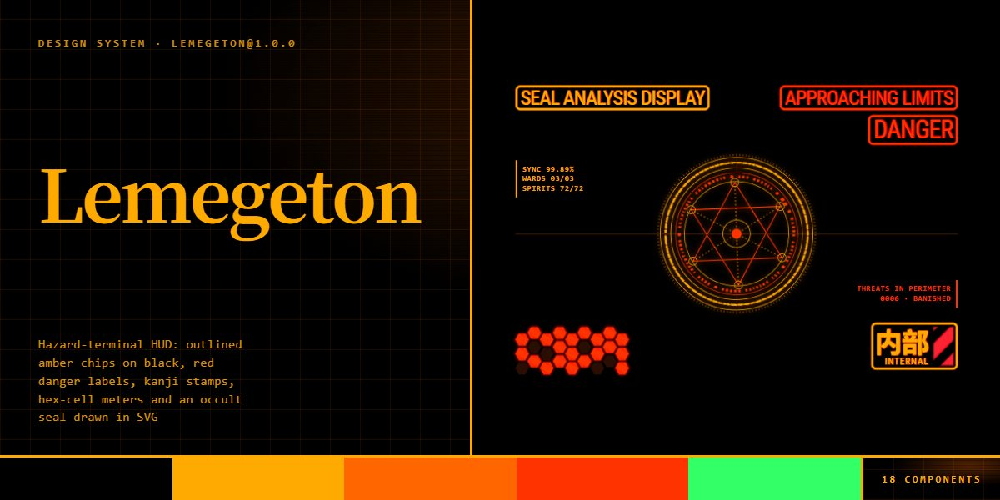

# Lemegeton · design system

`lemegeton@1.0.0` · 18 components · 67 tokens · dark

A dark FUI language for security, developer and sci-fi products: black under a ruled amber grid, outlined amber chips and buttons with a 1px glow ring inside and out, red danger labels whose glow pulses, green status pills, Mincho kanji stamps beside a heavy condensed-serif display set uppercase, and a scanline layer any box can carry. Hexagon-cell meters blink in danger, amber, green and seven rank colours; striped hazard decals frame panels; an occult seal drawn in SVG turns its rings in opposite directions; ward cards, a scan terminal whose three cores vote, a summon panel and a spirit grid with generated sigils complete it. An alert mode retints every glow and outline red from one class. Extracted from the Hazard Terminal Security page.

The full board, every component at once: [preview.jpg](preview.jpg)

**Explore it live:** [instalanding.ai/systems/lemegeton](https://instalanding.ai/systems/lemegeton) — every component rendered, a token playground and COPY FOR AGENT.

## Files

| File | What it is |
| --- | --- |
| [`specimen.html`](specimen.html) | Every component live in one file. Each is a `<section data-component>`; the markup inside `.sp-demo` is the component. Opens from disk. |
| [`tokens.css`](tokens.css) | The design tokens as CSS custom properties (`--lm-*`). |
| [`lemegeton.css`](lemegeton.css) | Tokens plus every component's CSS, scoped under `.lm` with `lm-` class names, so it can't restyle anything else on your page. |

## Use it

1. Load the fonts: `<link rel="stylesheet" href="https://fonts.googleapis.com/css2?family=Roboto+Condensed:wght@400;700&family=Noto+Serif+JP:wght@700&display=swap">`
2. Link `lemegeton.css` and wrap the part of your page that uses the system in `
`.
3. Copy components from `specimen.html`. Interactive ones need the small script in its `<script id="lm-components-js">`, and any that draw SVG art need its `<svg id="lm-defs">`.
4. Change the look by editing the tokens, not the components.

## Components

- Top bar
- Buttons & links
- Labels, pills & stamps
- Display type & scanlines
- Hex-cell meters
- Seal HUD
- Alert mode
- Section nav
- Readout strip
- Ward cards
- Scan terminal
- Search & rank filters
- Summon panel
- Spirit grid
- Directives
- Pacts
- Hazard CTA
- Footer

## Conventions

**Typography**

- Three system stacks: --lm-font-cond (Roboto Condensed first, font-stretch: condensed) for UI, labels and body; --lm-font-serif (Hiragino / Yu Mincho / Noto Serif JP) for display headings and every kanji; --lm-font-mono for figures, prices, codes and the terminal.
- Display type is the serif at 700, uppercase, tracking -.03em to -.04em, line-height .9 to .95, in --lm-white with a soft glow; one word can turn --lm-danger. Sizes: --lm-hero, --lm-final, --lm-summon, --lm-h2.
- Everything else is condensed, uppercase and tracked +1px to +3px. Sizes are multiples of --lm-fs (14px): --lm-small (.93), --lm-micro (.86), --lm-label-lg (2.3) for HUD labels.

**Color**

- Black (--lm-black) under a ruled grid drawn in --lm-glow at 5.5%. --lm-amber is text, outlines and fills; --lm-glow is every halo and line (--lm-line 45%, --lm-line-soft 18%). Glows are color-mix() of a hex token, never rgba triplets, so editing one token recolours its halos.
- Red means danger only: --lm-danger for labels and hits, --lm-danger-fill for hazard stripes, --lm-danger-glow for their halos. Green (--lm-ok) means live or safe: status pills, clean scan lines, blinking dots.
- Rank classes (.lm-R-King, Duke, Prince, Marquis, President, Earl, Knight, Blood) set --lm-accent and --lm-accent-glow for everything inside: cards, filters, plans, pills with lm--rank and hex cells with lm--rank.
- Alert mode: add .lm-alert to the root or any element inside it to swap the glow, amber, dim and muted to the alert reds; rank colours keep their hues.

**Shapes & HUD parts**

- Outlines are 2px (--lm-border) for chips, cards and rules, 3px (--lm-border-heavy) for primary panels, with a 1px glow ring inside and out (lm-bordered on labels; heavy panels repeat it in box-shadow). Radii: --lm-r-card 10px, --lm-r-panel 8px, --lm-r-btn 6px, --lm-r-chip 5px.
- Labels: .lm-label plus lm-bordered, a tone (lm--danger, lm--ok, lm--rank) and a size (lm-mini, lm-sm, lm-short); lm-blink pulses a red glow without dimming the text. Kanji stamps: .lm-eyebrow (solid amber kanji + outlined caption), .lm-klabel (big kanji, caption, striped .lm-decal).
- Hex meters: .lm-hex-grid > .lm-hex-row > .lm-hex cells, toned with lm--amber, lm--ok or lm--rank (default danger), lm-sm for small cells, lm-off for dark cells, lm-blink to blink. Hazard stripes: lm-striped (red) or lm-striped lm--amber.
- The seal, ward emblems and sigils are inline SVG in currentColor with drop-shadow glows; the scanline layer is 
 inside a positioned box (lm-smooth on the root hides it).

**Motion**

- Transitions run --lm-dur (.45s); cards lift over --lm-dur-lift on --lm-ease. Blinks are stepped (--lm-step) over --lm-dur-blink with offsets by row and column; danger labels pulse over --lm-dur-pulse.
- Rings turn linearly and slowly: the seal's outer ring --lm-dur-seal (300s), its inner ring --lm-dur-seal-inner (120s) in reverse; ward emblems --lm-dur-ward and --lm-dur-ward-inner.
- lm-static on the root (the top bar's pause button, or a click on the seal) stops every spinner, blink and pulse; prefers-reduced-motion does the same. Every component is complete when still.

**Accessibility**

- Body text is --lm-text on black; rank colours are tuned for 7:1 on black. Blinks are decorative: a blinking label never drops below its contrast.
- Toolbar and filter buttons are real buttons with aria-pressed; the filter row is a labelled group; the search field is a label with an aria-label on the input. Kanji, hex keys and drawings are aria-hidden.
- Focus is a 3px --lm-white outline offset 3px on links, buttons, inputs and the search box (focus-within).

## Extracted from

- [Hazard Terminal Security Page](../../pages/hazard-terminal-security-page) · [live](https://instalanding.ai/demos/lemegeton-antivirus.html)

Every system is extracted from a real, working page: the components are its markup, not a redraw.

MIT.
