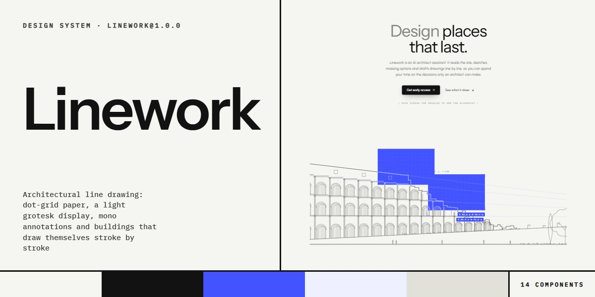

# Linework · design system

`linework@1.0.0` · 14 components · 66 tokens · light

A technical drawing language for architecture, engineering, property and AI tools that make things: warm off-white paper (#F5F5F1) under a 22px dot grid, ink (#121212) for type and lines, and one electric blue (#4353FF) for selection, guides and the blueprint. Instrument Sans at 400 sets the display light and tight ("Design places that last.", its first word in muted grey), Urbanist carries copy, and IBM Plex Mono writes every small label the way a drawing is annotated: eyebrows in parentheses, sheet numbers, scales, levels and dimensions. The pictures are drawings, not images: every stroke is an SVG path with pathLength="1" and one of nine line-weight tokens, from a 1.5px outline down to a .5px hatch, and it draws itself in when it comes into view. The hero is an amphitheatre with a roaming 300×190 blueprint lens (blue ground, white grid, the same drawing in white) that follows the pointer and reads out its position in metres; nine buildings stand on a filterable skyline with a blue callout; a project panel opens a shaded render in a circle from the pointer and a compare sheet splits drawing from render; a community house is built in five stages, the current one in blue. Hairline white sheets, 6px ink buttons that turn blue, round outline arrows and pill chips keep the chrome quiet. Extracted from the Linework AI architect assistant page, whose drawings are generated by its own script and ship here as static SVG.

The full board, every component at once: [preview.jpg](preview.jpg)

**Explore it live:** [instalanding.ai/systems/linework](https://instalanding.ai/systems/linework) — every component rendered, a token playground and COPY FOR AGENT.

## Files

| File | What it is |
| --- | --- |
| [`specimen.html`](specimen.html) | Every component live in one file. Each is a `<section data-component>`; the markup inside `.sp-demo` is the component. Opens from disk. |
| [`tokens.css`](tokens.css) | The design tokens as CSS custom properties (`--lw-*`). |
| [`linework.css`](linework.css) | Tokens plus every component's CSS, scoped under `.lw` with `lw-` class names, so it can't restyle anything else on your page. |

## Use it

1. Load the fonts: `<link rel="stylesheet" href="https://fonts.googleapis.com/css2?family=IBM+Plex+Mono:wght@400;500&family=Instrument+Sans:wght@400;500;600&family=Urbanist:wght@400;500;600&display=swap">`
2. Link `linework.css` and wrap the part of your page that uses the system in `
`.
3. Copy components from `specimen.html`. Interactive ones need the small script in its `<script id="lw-components-js">`.
4. Change the look by editing the tokens, not the components.

## Components

- Header & menu
- Buttons, links & chips
- Type, eyebrows & labels
- Line weights & dimensions
- Drawing hero & blueprint lens
- Service sheet & drawn icons
- Project skyline & filters
- Project panel: drawing & render
- Project sheet & compare slider
- Stage drawing & stepper
- Studio figure, principles & stats
- Quote carousel
- Early-access form
- Footer & harbour city

## Conventions

**Typography**

- Instrument Sans (--lw-font-display) at weight 400 sets every heading, light and tight: the hero display at --lw-display (--lw-display-xl from 1280px, .96 line height, -.035em) with its first word in --lw-muted, h2s at --lw-h2 (.lw-h2, -.035em), sheet and studio h2s at --lw-h2-sheet / --lw-h2-studio (-.03em), h3s at --lw-h3, quotes at --lw-quote and stat figures at --lw-stat. Never bold it; the wordmark is the only 500.
- Urbanist (--lw-font-body) carries copy at --lw-body; leads (.lw-lead) are --lw-lead (17px/1.65) at 70% ink. Buttons, links and chips are Urbanist 500.
- IBM Plex Mono (--lw-font-mono) writes every small label: eyebrows (.lw-eyebrow) in parentheses, capitals, --lw-label with .14em tracking and --lw-muted (a <b> inside turns blue); counters (.lw-mono, No. 01 / 09); dt labels; hints; status pills; and the text drawn into SVG (.lw-lbl). Mono is never used for sentences longer than a caption.

**Colour & paper**

- The ground is --lw-paper, usually with the dot grid (.lw-dots: --lw-dot dots every --lw-grid). Content that needs a surface sits on a white --lw-sheet with a --lw-hair --lw-rule border; big sheets add --lw-shadow-sheet. Tiles sit on --lw-tile.
- Ink (--lw-ink) is type, lines and the primary button; text tints are made with color-mix from it (70% for copy, 60% for meta). Blue (--lw-blue) is the one accent and always means "selected" or "construction": the active building, the current stage, guides and dimensions, the lens, the chosen dot. --lw-blue-soft backs badges and notes.
- The footer is the only ink band: white type at 50-80% (--lw-on-ink mixed down) and the city drawn in white at 62%.

**Drawings & annotation**

- Every picture is SVG line work, never a photo or a raster. A stroke is <path class="lw-st lw-s?" pathLength="1" d="…" style="--lw-d:120ms;--lw-dur:800ms"> with one weight class: .lw-so outline, .lw-sl line, .lw-sT entourage (trees, people), .lw-sw window, .lw-sd detail, .lw-sg guide (blue), .lw-ss surface, .lw-sh hatch; .lw-sx is a dashed blue construction axis. Each weight is a --lw-stroke-* token; set --lw-sw on a drawing to scale all of them (the skyline uses 2.3, panels compute it from the viewBox).
- Put data-lw-draw on a drawing (or its wrapper) and the script draws it in when it scrolls into view: strokes animate their dash offset over --lw-dur (default --lw-dur-draw) on --lw-ease-draw after --lw-d (+ --lw-bd for a whole building). Order the delays like a draughtsman: ground, outline, structure, openings, detail, hatch, then trees and people. Without the script, drawings simply show finished.
- Annotate with mono .lw-lbl text at 10-13 units: dimension lines in .lw-sg with end ticks and the value rotated alongside (29.2 M), level marks with a triangle (±0.00, +27.00), a north point, a scale bar with a SCALE 1:200 label, and DETAIL callouts in blue corner marks. Section fills use the 45° blue hatch <pattern> (stroke-opacity .32); keep each drawing's patterns in its own <defs>.
- Selection is a blue state on the drawing itself: .lw-active turns a building blue, lifts it 12px and shows its hatch and axes; .lw-muted drops the rest to 14%. The blueprint lens (svg[data-lw-lens] around a .lw-ink group) is built by the script; give the svg data-lw-g (ground y) and data-lw-x0 (origin x) so its readout is in metres.
- Renders are allowed only as the reveal behind a drawing: .lw-pv opens .lw-ph in a circle from the pointer, .lw-dart splits drawing and render with a range input. The drawing always comes first.

**Buttons & forms**

- The primary is .lw-btn: a 44px ink block at --lw-r-btn with Urbanist 500, white text, an arrow icon (.lw-i) and --lw-shadow-btn; hover turns it blue with --lw-shadow-btn-hover and steps the arrow up-right. On ink use .lw-btn.lw-btn-w. Pair it with .lw-link (80% ink, blue underlined on hover).
- Round 44px .lw-circ buttons (hairline, white on hover) step through things; give them aria-labels. Filters are .lw-chip pills with a mono count and aria-pressed (pressed fills ink). Status is a mono .lw-pill with a blue dot; a category is a soft blue .lw-badge.
- Forms (.lw-form) use mono capital labels over paper-filled fields with hairline borders at --lw-r-btn; focus swaps the border to blue and the fill to white, with no outline glow. On send the form gets .lw-done and the .lw-sent note after it shows; the demo sends nothing.

**Motion**

- Two curves: --lw-ease (cubic-bezier(.2,.8,.2,1)) for UI and reveals, --lw-ease-draw (cubic-bezier(.65,.05,.25,1)) for strokes. Hovers take --lw-dur-quick to --lw-dur-state; reveals (data-lw-reveal) rise 18px over --lw-dur-reveal; panel details slide in over --lw-dur-swap.
- Drawing is the signature motion: lines draw in once, in order, and stay. The hero draws over about three seconds, a blue scan line sweeps it once (--lw-dur-scan), then the lens roams on a slow figure-of-eight and follows the pointer, pausing off screen. The stepper redraws as stages change, the current stage blue for 1.2s before it settles to pencil grey.
- Loops are rare and slow: the studio figure's walker (--lw-dur-walk) and the quote carousel's 8s advance. Counters run once over 1.4s. Under prefers-reduced-motion strokes show finished, reveals show at once, the lens parks and only follows the pointer, and the carousel stops advancing.

**Accessibility**

- Focus is a 2px blue outline offset 3px everywhere. Decorative drawings are aria-hidden; drawings that carry meaning (the hero, the stage drawing, the city, the studio figure) are role="img" with an aria-label that says what is drawn.
- The skyline's buildings respond to pointer only; the numbered ticks under it are the keyboard path and each carries the building's name in .lw-sr text. The panel's drawing is a role="button" with aria-pressed that toggles the render on Enter or Space; the compare slider is a labelled range input.
- Chips and quote dots use aria-pressed, the current stage step aria-current="step", the burger aria-expanded with aria-controls (Escape closes the sheet and returns focus). The panel details and the quote counter are aria-live="polite"; the sent note takes role="status" and focus.
- Body copy stays at 70% ink or more on paper and sheet; muted grey is for labels only. Never put blue text on --lw-blue-soft smaller than 12px.

## Extracted from

- [Linework AI Architect Assistant Page](../../pages/linework-ai-architect-assistant-page) · [live](https://instalanding.ai/demos/linework-architect-assistant.html)

Every system is extracted from a real, working page: the components are its markup, not a redraw.

MIT.
