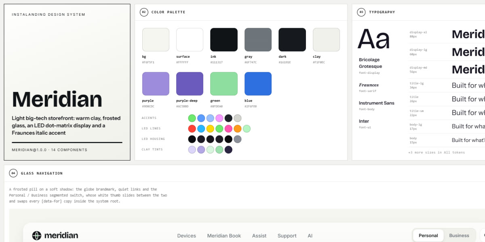

# Meridian · design system

`meridian@1.0.0` · 14 components · 84 tokens · light

Warm clay surfaces with soft neumorphic depth, frosted-glass navigation, a dot-matrix LED metro board and ticker, Bricolage Grotesque headlines lit by one glowing Fraunces italic word, and a Personal / Business switch that re-themes the whole system. Extracted from the LED Metro Tech Storefront landing page.

**Explore it live:** [instalanding.ai/systems/meridian](https://instalanding.ai/systems/meridian) — every component rendered, a token playground and COPY FOR AGENT.

## Files

| File | What it is |
| --- | --- |
| [`specimen.html`](specimen.html) | Every component live in one file. Each is a `<section data-component>`; the markup inside `.sp-demo` is the component. Opens from disk. |
| [`tokens.css`](tokens.css) | The design tokens as CSS custom properties (`--md-*`). |
| [`meridian.css`](meridian.css) | Tokens plus every component's CSS, scoped under `.md` with `md-` class names, so it can't restyle anything else on your page. |

## Use it

1. Load the fonts: `<link rel="stylesheet" href="https://fonts.googleapis.com/css2?family=Bricolage+Grotesque:opsz,wght@12..96,400..800&family=Fraunces:ital,opsz,wght@1,9..144,300..600&family=Instrument+Sans:wght@400..700&family=Inter:wght@400;500;600;700;800&display=swap">`
2. Link `meridian.css` and wrap the part of your page that uses the system in `
`.
3. Copy components from `specimen.html`. Interactive ones need the small script in its `<script id="md-components-js">`, and any that draw SVG art need its `<svg id="md-defs">`.
4. Change the look by editing the tokens, not the components.

## Components

- Glass navigation
- Buttons
- Headline pairing
- Badges & pills
- LED metro display
- Dot-matrix ticker
- Assist card
- Quick links
- Feature slider
- Product banner
- Story cards
- FAQ
- Dark banner
- Footer

## Conventions

**Typography**

- Headlines are Bricolage Grotesque 700-800 with tight negative tracking (--md-display-*), and carry exactly one Fraunces italic word in <em>: a lilac gradient (green on dark, blue in Business) with a soft SVG glow from #md-defs.
- Body copy is Instrument Sans 15-17px in --md-gray at line-height 1.6; one phrase per paragraph is lifted to --md-ink in <strong>.
- Labels and eyebrows are Inter 600-700 at 11-12px, uppercase with wide tracking; the section eyebrow leads with a blinking green LED dot. Spec values set in Fraunces italic.

**Layout**

- Content sits in a 1320px column with a 40px gutter; sections open with 130px of space and a two-part head (title left, description right).
- Cards are generously rounded (22-32px, pills at 999px) and sit on a 12-20px gap; tile rows (quick links, story cards) use minmax(0, 1fr) columns that collapse to one column on phones.
- Personal and Business copy live side by side as [data-for] blocks; the switch toggles .md-business on the root and the right set shows.

**Clay & glass**

- Raised things are clay: a white or tinted fill with an outer drop shadow plus inner highlight and inner shade (--md-shadow-clay, -dark, -purple, -green). Never a flat fill for an icon tile or knob.
- Chrome floating over content is frosted glass: --md-glass with --md-glass-blur, a 1px white rim and --md-shadow-soft.
- Light is the accent: LED dots and the ticker glow on a near-black housing (--md-led-*), and Fraunces accents carry a soft bloom. Keep the warm off-white ground; dark panels are the exception.

**Motion**

- Everything eases on --md-ease-out (cubic-bezier(.2, .8, .2, 1)) over --md-dur-fast to --md-dur-slide; the segmented thumb slides on --md-ease-switch.
- Hover rewards are small: the dotted-arrow knob animates, arrows turn 45°, quick-link tiles fill dark from the bottom, chips invert.
- Ambient loops are LED-only (chase, rainbow hues, breathe, blink, the stepped ticker, orbit rings); prefers-reduced-motion stops them and the transitions.

**Accessibility**

- The Personal / Business switch and LED mode buttons are real buttons with aria-pressed; line swatches have aria-labels and aria-pressed.
- FAQ questions are buttons with aria-expanded; answers open on measured height.
- LED boards are aria-hidden decoration; the ticker carries its whole message in aria-label. Grey text stays at or above --md-gray on the clay ground.

## Extracted from

- [LED Metro Tech Storefront](../../pages/led-metro-tech-storefront) · [live](https://instalanding.ai/demos/meridian-led-storefront.html)

Every system is extracted from a real, working page: the components are its markup, not a redraw.

MIT.
