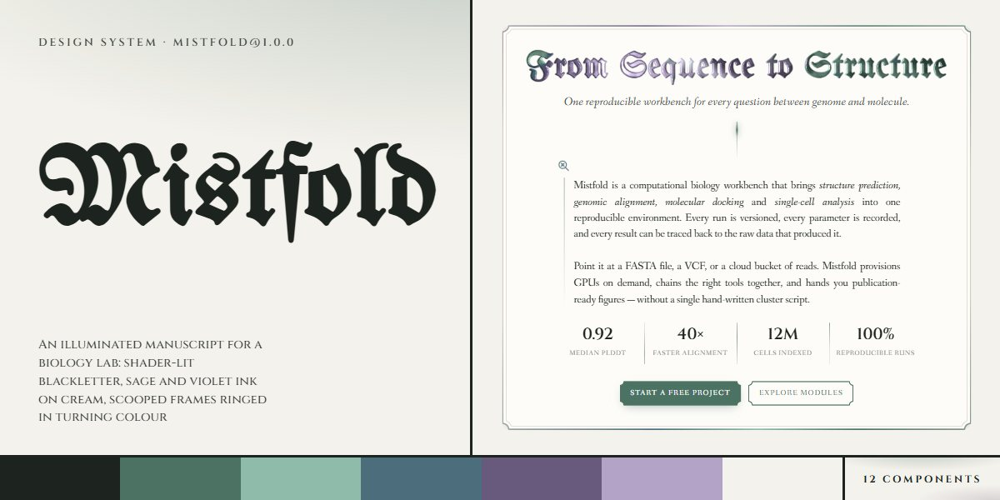

# Mistfold · design system

`mistfold@1.0.0` · 12 components · 115 tokens · light

A manuscript language for scientific software, research tools and any product with a literary or archival voice: cream paper and white cards, UnifrakturMaguntia blackletter for every heading, Fanwood Text with italic subtitles for reading, Cinzel for numerals and small-caps heads, and JetBrains Mono for code. Content sits in 760px frames with scooped corners, an inset hairline and a conic ring of sage, mint, blue, violet and lilac under a soft glow. Headings fill with a drifting sage gradient, then a WebGL shader paints them with lit, bevelled fbm ink that follows the pointer. Ornaments do the dividing: a vertical rule that draws down with a travelling spark, the ❦ fleuron between fading rules, four-point star bullets. Module cards carry a 3px accent spine, hexagon pips and a tinted two-cell foot; steps sit on pearl medals; buttons are small capitals with 6px scooped corners; line icons are stroked by one sage-to-violet gradient. Extracted from the Blackletter Biology Workbench page.

The full board, every component at once: [preview.jpg](preview.jpg)

**Explore it live:** [instalanding.ai/systems/mistfold](https://instalanding.ai/systems/mistfold) — every component rendered, a token playground and COPY FOR AGENT.

## Files

| File | What it is |
| --- | --- |
| [`specimen.html`](specimen.html) | Every component live in one file. Each is a `<section data-component>`; the markup inside `.sp-demo` is the component. Opens from disk. |
| [`tokens.css`](tokens.css) | The design tokens as CSS custom properties (`--mf-*`). |
| [`mistfold.css`](mistfold.css) | Tokens plus every component's CSS, scoped under `.mf` with `mf-` class names, so it can't restyle anything else on your page. |

## Use it

1. Load the fonts: `<link rel="stylesheet" href="https://fonts.googleapis.com/css2?family=Fanwood+Text:ital@0;1&family=Cinzel:wght@400..900&family=UnifrakturMaguntia&family=JetBrains+Mono:wght@400;600&display=swap">`
2. Link `mistfold.css` and wrap the part of your page that uses the system in `
`.
3. Copy components from `specimen.html`. Interactive ones need the small script in its `<script id="mf-components-js">`, and any that draw SVG art need its `<svg id="mf-defs">`.
4. Change the look by editing the tokens, not the components.

## Components

- Header
- Buttons, labels & fields
- Blackletter type
- Rules & fleurons
- Instrument icons
- Illuminated hero
- Small-caps stats
- Module card
- Module codex
- Ritual steps & code
- Covenant tiers
- Call to action & footer

## Conventions

**Typography**

- Every heading is blackletter: UnifrakturMaguntia (--mf-font-display) at weight 900, line-height 100%, centred, filled with --mf-title-grad clipped to the text and drifting on mf-moveGradient. h1s wrap the words in  (--mf-display, 58px); h2s are <h2 class="mf-title"> (--mf-title, 44px). Both are styled only inside a .mf-frame. Card names (.mf-name) are blackletter in the card's --mf-accent.
- Reading text is Fanwood Text (--mf-font-text) at --mf-text (17px) / 1.55; frames justify it. Subtitles, quotes and emphasis are italic, never bold (an intro's <b> is italic ink-strong). Numerals, prices, step titles and footer heads are Cinzel (--mf-font-numeral) 600; labels, links and buttons are small uppercase Fanwood at 9.5-12px with 0.5-1.5px tracking.
- The component script lights every .mf-frame .mf-display, .mf-frame h2.mf-title, the header .mf-logo and the .mf-finale-mark wordmark with a WebGL shader in the five illumination tokens. The real text stays in the DOM and only turns transparent (.mf-shaded) after the shader draws, so the gradient text is the fallback; let UnifrakturMaguntia load before layout.

**Color & composition**

- Cream paper (--mf-paper) under three faint radial washes of sage, violet and blue; frames fill with --mf-card, cards and tiers with --mf-white, steps with --mf-tint. Text is --mf-ink, headings and figures --mf-ink-strong, meta --mf-ink-soft.
- Sage (--mf-sage) is the one action colour: buttons, label pills, links, rules, the fleuron, focus rings. Mint, blue, violet and lilac only appear together in the rings, the medal rims, the icon gradient and the shader. Module cards take one accent each through style="--mf-accent:var(--mf-sage|blue|violet|mauve)"; the house accents (ochre, umber, moss, olive, oxblood, plum, rust) are spare accents for more cards.
- Everything sits in a .mf-frame (760px, --mf-frame-pad, --mf-frame-gap below), stacked down a single centred column; inner blocks narrow further (intro 560px, cards 580px, flow 620px, tiers 680px). The finale frame widens to 1000px. Section heads read top-down: label pill, h2, vertical .mf-rule, intro, .mf-fleuron.

**Ornament & shape**

- Corners are 6-14px radii with corner-shape: scoop (--mf-corner); browsers without it show plain rounded corners. Frames and tiers add an inset 1px hairline outline (--mf-frame-inset, --mf-tier-inset).
- The ring is a :before border filled with conic-gradient(from var(--mf-angle), var(--mf-ring-stops)) over the card colour, plus a blurred :after in --mf-ring-glow-stops; mf-ringSpin turns --mf-angle (a registered @property) on the element itself. It belongs to .mf-frame and the featured .mf-tier.mf-feat only.
- Dividers are ornaments, never plain lines: .mf-rule (60px vertical fade), .mf-fleuron and .mf-finale-rule (❦ between fading rules), gradient border-images on the intro and stats. Bullets are the four-point --mf-star mask, in the accent or --mf-star-grad.
- Icons are 24px line drawings from the defs: <svg class="mf-icon"><use href="#mf-i-lens|scope|hex|atom|folio|funnel|branch|surge|codex|seal"/></svg>, stroked 1.5px by the #mf-ig gradient (include the defs once). Steps put an icon on a .mf-medal; compute ratings are three .mf-hex pips with .mf-on filled.

**Motion**

- Slow and continuous: frames and the featured tier run mf-ringSpin over --mf-ring-spin (9s; 6s on the tier), heading gradients drift over --mf-shimmer, the finale aurora breathes over --mf-aurora. Medal rims spin only on hover (--mf-medal-spin).
- The hero plays once: the rule draws down on --mf-ease-out, a spark travels it on --mf-ease-spark, light sweeps the intro rule on --mf-ease-sweep, and the stats rise in at 120ms steps. Cards fade up 16px over --mf-dur-reveal when they enter (the script adds .mf-in); buttons and fields change over --mf-dur.
- Under prefers-reduced-motion every animation and transition stops, rings hold at 35deg, cards show at once and the shader draws one still frame. The page's Rough.js margin sketches are page decoration and not part of the system.

**Accessibility**

- One h1 per page; shader canvases, rules, fleurons, ornaments and icons are aria-hidden; the real heading text stays readable to screen readers under the canvas.
- The email field carries an aria-label; the thank-you line is aria-live="polite". The code block is focusable (tabindex="0") with an aria-label so it can scroll by keyboard.
- Focus shows a 2px sage outline (--mf-focus) offset 3px. Body text is --mf-ink on cream and white; keep small uppercase text at --mf-ink-soft or darker.

## Extracted from

- [Blackletter Biology Workbench](../../pages/blackletter-biology-workbench) · [live](https://instalanding.ai/demos/mistfold-biology-workbench.html)

Every system is extracted from a real, working page: the components are its markup, not a redraw.

MIT.
