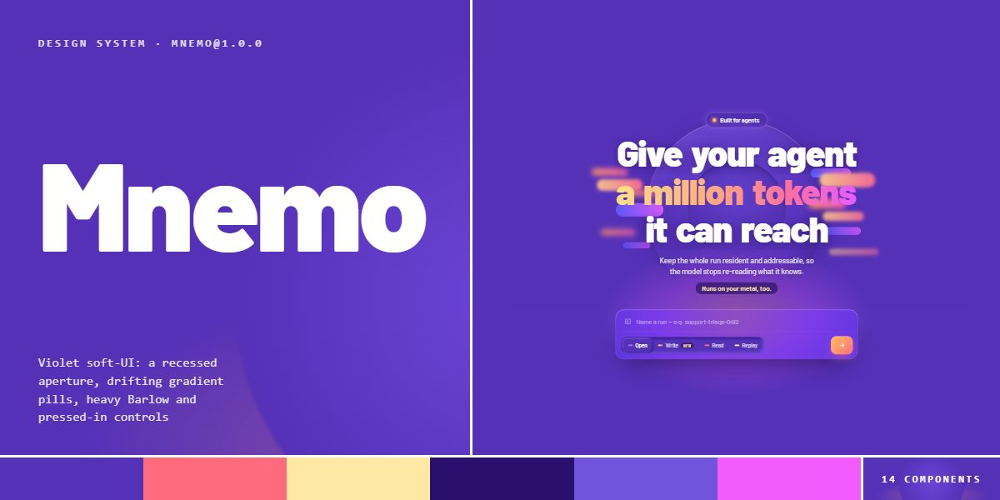

# Mnemo · design system

`mnemo@1.0.0` · 14 components · 119 tokens · dark

A saturated, tactile language for AI infrastructure and agent tooling: one flat violet field (#5531B8) that every surface is filled with, raised and pressed in by paired light and shade (--mn-nm-lit / --mn-nm-dim) in the soft-UI manner. The hero is a big recessed circular aperture lit like a dome, with three depth layers of gradient pills drifting through it (crisp, then blurred, then more blurred) that follow the pointer. Barlow at 800-900 carries the headlines with a yellow-to-pink gradient phrase, Barlow Condensed sets the uppercase labels in cream, and frosted glass is kept for the things you type into: the prompt bar with its pressed tab well and orange send tile, the terminal window whose JSON types itself in, and the newsletter card under a glowing domed planet. Working parts are soft too: switches and a budget slider in wells, nested recessed rings carrying an SVG arc, and a strip of spans that changes state as an eviction policy runs. Extracted from the Mnemo context-window page.

The full board, every component at once: [preview.jpg](preview.jpg)

**Explore it live:** [instalanding.ai/systems/mnemo](https://instalanding.ai/systems/mnemo) — every component rendered, a token playground and COPY FOR AGENT.

## Files

| File | What it is |
| --- | --- |
| [`specimen.html`](specimen.html) | Every component live in one file. Each is a `<section data-component>`; the markup inside `.sp-demo` is the component. Opens from disk. |
| [`tokens.css`](tokens.css) | The design tokens as CSS custom properties (`--mn-*`). |
| [`mnemo.css`](mnemo.css) | Tokens plus every component's CSS, scoped under `.mn` with `mn-` class names, so it can't restyle anything else on your page. |

## Use it

1. Load the fonts: `<link rel="stylesheet" href="https://fonts.googleapis.com/css2?family=Barlow+Condensed:wght@400;500;600;700&family=Barlow:wght@300;400;500;600;700;800;900&display=swap">`
2. Link `mnemo.css` and wrap the part of your page that uses the system in `
`.
3. Copy components from `specimen.html`. Interactive ones need the small script in its `<script id="mn-components-js">`.
4. Change the look by editing the tokens, not the components.

## Components

- Buttons & chips
- Soft-UI wells & switches
- Recessed aperture hero
- Prompt bar
- Terminal window
- Logo strip
- Nav pill & menu sheet
- Section head & feature cards
- Stat wells
- Three steps
- Eviction console
- Plans
- FAQ
- Newsletter dome & footer

## Conventions

**Soft UI**

- The ground is one flat colour, --mn-bg-1, and every soft surface is filled with exactly that colour: .mn-nm sets it and becomes a stacking context (z-index 0); its shadows live on ::before/::after at z-index -1. Never put a gradient behind soft surfaces or give one overflow:hidden, or the shadow is clipped and it reads flat.
- Raise with .mn-nm.mn-nm--offset (--mn-raise, or the smaller --mn-raise-sm / --mn-raise-xs on pills, tabs and discs); press in with .mn-nm--inset (--mn-press, --mn-press-sm, --mn-well for switches and the slider track); pillow a dot with .mn-nm--inner (--mn-inner). Light always comes from the top left (--mn-nm-lit) and shade falls bottom right (--mn-nm-dim, rgba(22, 6, 72, …)).
- State is depth: the selected tab rises out of its well, a held card presses flat, the current menu row is pressed in with a warm bar, the open FAQ's shadow softens, and a switch's knob slides on --mn-cubic and turns coral.

**Aperture, pills & glass**

- The hero aperture is .mn-scene: a .mn-disc (--mn-aperture, lit as a dome) and three .mn-layer.mn-l-one/two/three each holding four .mn-piece pills; the near layer is crisp --mn-pill-cool, the middle --mn-pill-warm at --mn-blur-mid, the far --mn-pill-coral at --mn-blur-far. Pills sway outward on --mn-dur-sway / --mn-iris so the headline stays clear. Layers carry data-mn-depth and follow the pointer; keyframe a child, never the layer.
- Glass is for things you type into or read from: the prompt bar (.mn-ask), the terminal window (.mn-win), the nav pill and the newsletter card. They sit on violet at 26-40% with --mn-frost and --mn-glass (or --mn-frost-card / --mn-glass-card), and a hairline of 20% white.
- Glows are warm and soft: the coral breathing glow under the hero copy, the badge's amber dot and violet halo (--mn-badge-glow), the send tile's --mn-go-glow, the dome's pink rim and the orbit's glowing dots.

**Typography**

- Barlow (--mn-font-sans) carries everything. Headlines are heavy: the hero h1 is 900 at --mn-display with -.025em tracking and a touch of word-spacing, its lines rising out of masks; section h2 is 700 at --mn-h2; the finale h2 900 at --mn-h2-card. One phrase per headline is an <em> in the warm gradient (yellow through peach to pink).
- Barlow Condensed (--mn-font-cond) is the label voice: uppercase, 1.4-4px tracking, in --mn-cream (eyebrows, plan names, step numbers, tags) or 40-70% white (hints, readouts, axis labels, logos). Never set body copy condensed.
- Figures are 800-weight in the warm gradient (stats, the dial). Code and ids are --mn-font-mono: JSON keys white, strings coral, numbers cream, booleans mauve, line numbers at 28% white.

**Colour**

- Violet is the whole field: --mn-bg-1 for surfaces, --mn-bg-2 for dark chips and the badge's inner disc, --mn-bg-3 for text shadows; the finale darkens down through --mn-finale-mid and --mn-finale-deep. Copy is white at 82-88%; quiet text 40-70%.
- Coral (--mn-coral) is the signal (switch knobs on, cited spans, busy status, warnings); cream (--mn-cream) is the label and focus colour (2px cream focus outlines everywhere); the send and Subscribe buttons are the only orange fills.
- Gradients stay on small things: pills, bars, the dot marks, the em phrase and figures. --mn-g-warm and --mn-g-cool are the two everyday ones.

**Layout & motion**

- Content sits in .mn-wrap (--mn-wrap, minus --mn-gutter); sections are .mn-sec (--mn-sec top and bottom). The nav, scrim and sheet are position:absolute in the system, and the component ships inside .mn-navframe, a 560px frame that contains them so it previews as a card. On a page, drop the frame, pin .mn-nav with position:fixed and add .mn-scrolled once the page scrolls 24px.
- Entrances land one after another: the aperture irises open on --mn-iris over --mn-dur-iris, then the badge, the headline lines (--mn-dur-rise), the sub and the card (--mn-dur-lift), then the window, whose JSON lines type in 55ms apart. Presses spring on --mn-cubic (--mn-dur-press); surfaces settle on --mn-ease (--mn-dur-surface).
- Under prefers-reduced-motion every animation and transition is cut to nothing, the pills stop and the parallax never starts.

**Accessibility**

- The aperture, pills, dome and orbit are aria-hidden decoration. Switches are buttons with aria-pressed; the prompt modes are role="tab" with aria-selected; the burger has aria-expanded and the sheet is role="dialog"; Escape closes it.
- The budget slider is a real range input laid invisibly over its well, with an aria-label; the verdict is aria-live so policy changes are read out.
- White copy on --mn-bg-1 passes; keep cream and coral for labels, figures and accents rather than long copy.

## Extracted from

- [Recessed Aperture Hero Page](../../pages/recessed-aperture-hero-page) · [live](https://instalanding.ai/demos/mnemo-context-window.html)

Every system is extracted from a real, working page: the components are its markup, not a redraw.

MIT.
