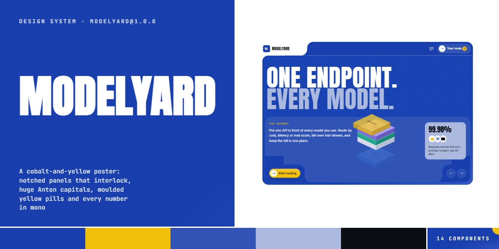

# Modelyard · design system

`modelyard@1.0.0` · 14 components · 67 tokens · light

A cobalt-and-yellow poster language for AI infrastructure, model gateways, API platforms and developer tools: big cobalt panels whose rounded corners interlock through notches (no clip-path: each panel paints a square of its neighbour's colour behind its corner, so the curve reads as a bite out of the next block), huge Anton capitals with the second line tinted pale blue, Inter for copy and JetBrains Mono for eyebrows, prices, labels and every figure. Yellow is spent on one action per screen: a moulded plastic pill whose knob grows into a fill, the route count badge, the stage label. Stat panels carry big Anton numbers and slot-reel chips, catalog cards are four notched pieces around a benchmark plate, the policy console presses moulded toggles that re-price a readout, and an isometric stack of labelled layers floats over the hero. Extracted from the Modelyard model-router page.

The full board, every component at once: [preview.jpg](preview.jpg)

**Explore it live:** [instalanding.ai/systems/modelyard](https://instalanding.ai/systems/modelyard) — every component rendered, a token playground and COPY FOR AGENT.

## Files

| File | What it is |
| --- | --- |
| [`specimen.html`](specimen.html) | Every component live in one file. Each is a `<section data-component>`; the markup inside `.sp-demo` is the component. Opens from disk. |
| [`tokens.css`](tokens.css) | The design tokens as CSS custom properties (`--my-*`). |
| [`modelyard.css`](modelyard.css) | Tokens plus every component's CSS, scoped under `.my` with `my-` class names, so it can't restyle anything else on your page. |

## Use it

1. Load the fonts: `<link rel="stylesheet" href="https://fonts.googleapis.com/css2?family=Anton&family=Inter:opsz,wght@14..32,300..800&family=JetBrains+Mono:wght@400;500;600&display=swap">`
2. Link `modelyard.css` and wrap the part of your page that uses the system in `
`.
3. Copy components from `specimen.html`. Interactive ones need the small script in its `<script id="my-components-js">`, and any that draw SVG art need its `<svg id="my-defs">`.
4. Change the look by editing the tokens, not the components.

## Components

- Pills & round buttons
- Poster type
- Notched nav
- Notched hero & menu
- Stage & stat panel
- Isometric layer stack
- Logo strip
- Code panel
- Notched catalog cards
- Policy console
- Plan cards
- FAQ
- Signup panel
- Status footer

## Conventions

**Typography**

- Every heading is Anton at weight 400, always in capitals, line-height .9-1: the headline (.my-headline) at --my-display with its second line in an <em> tinted --my-blue-3; section titles at --my-h2 (catalog, pricing), --my-h2-code, --my-h2-console and --my-h2-cta; plan names at --my-h3; figures (.my-stat-num, .my-price) in Anton too.
- Inter carries the copy: --my-text body, --my-lead on the stage, 600 for questions and card names; secondary copy is --my-muted on white and 72-92% white on cobalt.
- JetBrains Mono carries everything that is data or a label: eyebrows (.my-eyebrow, --my-eyebrow, 500, .14em, capitals), the stage label in yellow, prices, model ids, plate heads, axis labels, meta lines, the readout estimate and the code. Use .my-mono for tabular figures inline.

**Color & composition**

- Cobalt panels on a white ground: big panels are --my-blue lit by --my-glow from the bottom-right (.my-lit) with the --my-grain overlay (.my-grain); the stage inside is --my-blue-2, stat panels --my-blue-3, plates shift between blue, blue-2 and blue-deep. Light pieces are --my-chip cards and the --my-soft signup panel; the strongest dark is --my-night (the featured plan) and --my-code-bg (terminals).
- Yellow (--my-yellow) is spent on one action per screen: the primary pill, the route count badge, the stage and console eyebrows, the readout keywords, pressed toggles and the focus ring. Never use it for large fills.
- Content sits in a --my-wrap column; sections stack with --my-s-xl before major blocks (catalog, pricing), --my-s-l between the rest and --my-s-m after the hero. Components carry no outer margin, so add it where they sit.

**The notch**

- The notch is not clip-path. Two neighbouring blocks share an edge; one rounds the corner that meets the other (--my-r on panels, --my-r-sm inside cards), and paints a square of the NEIGHBOUR's colour behind that corner with a ::after at z-index -5 (half the block's width and height, pinned to that corner), so the curve reads as a bite out of the neighbour.
- Pieces that do it: the nav brand tab over the cobalt bar (.my-nav-brand::after), the stage foot's three tabs (.my-foot-left, .my-foot-mid, .my-foot-right and .my-stage-foot::before/::after), and every catalog card (.my-card-price and .my-card-acts bite into each other).
- Each notched component needs its own stacking context so the -5 squares stay inside it: .my-nav, .my-header, .my-console, .my-footer and .my-pill make one; .my-card has isolation: isolate. Recolour a panel and recolour the square its neighbour paints, or the curve shows.

**Shapes & depth**

- Pills (.my-pill, --my-pill radius) come in three finishes: yellow (default, moulded --my-sh-raised, --my-sh-pressed on :active), .my-pill--ghost (hairline ring, fills cobalt) and .my-pill--glass (on cobalt, fills white). Markup: <a class="my-pill">svgLabel</a>; the knob behind the icon grows into the fill on hover.
- Round buttons (.my-btn-round, 36px hairline; .my-btn-round--blue, 44px glass on cobalt) turn cobalt on hover and cobalt with a yellow glyph when aria-pressed="true". Toggles (.my-toggle) are 66px moulded knobs (--my-sh-knob) in 74px wells that press in yellow (--my-sh-knob-on) when checked.
- Benchmark plates (.my-plate with --my-plate and --my-bar) draw seven bars from --my-v (0-100) on a 24px grid with mono axis labels; slot reels (.my-slot / .my-tslot with .my-reel[data-my-icon]) hold seven copies of a CSS icon (love, death, robot, loop). The isometric stack (.my-rig, five .my-box with --my-l, --my-rf, --my-t, --my-tx faces) shows from 1024px.

**Motion**

- Everything eases on --my-ease (cubic-bezier(.22,1,.36,1)), a soft overshoot-free settle. Pill knobs grow over --my-dur-fill, round buttons recolour over --my-dur-button, toggles press over --my-dur-press, the FAQ plus turns over --my-dur-turn and answers open over --my-dur-open.
- The burger blurs the hero's content out (--my-dur-swap) and lets the menu rows rise in one by one into the same cobalt panel. Slot reels spin past with a blur and settle on a loop; the rig's boxes drop in from alternating sides on --my-rig.
- Under prefers-reduced-motion the reels, the rig, the status ping and the menu choreography stop; the rig rests as a stacked tower.

**Accessibility**

- The burger has aria-controls, aria-expanded and a label that swaps between Open and Close menu; while open the menu and hero swap inert and aria-hidden, and Escape closes it.
- Route buttons are toggle buttons with aria-pressed and a model-specific aria-label; copy buttons announce Copied (or a select-to-copy fallback) through their label. FAQ rows are buttons with aria-expanded; toggles are real checkboxes with an aria-label.
- Focus shows a --my-focus yellow outline offset 3px. Decorative reels, the rig and icons are aria-hidden; the uptime strip is role="img" with a full description.

## Extracted from

- [Notched Panel Catalog Page](../../pages/notched-panel-catalog-page) · [live](https://instalanding.ai/demos/modelyard-router.html)

Every system is extracted from a real, working page: the components are its markup, not a redraw.

MIT.
