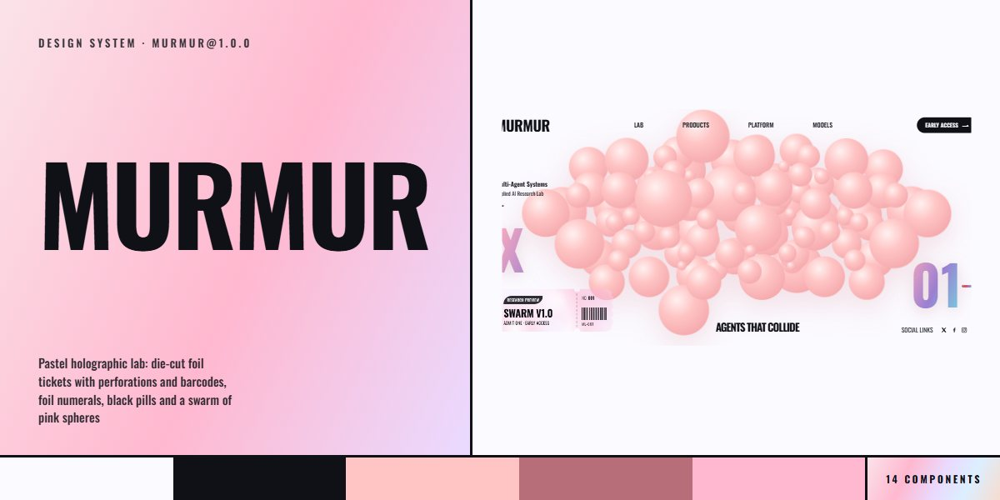

# Murmur · design system

`murmur@1.0.0` · 14 components · 119 tokens · light

A research-lab editorial language for AI labs, launches, events and anything sold as admission: a pale lab-white page (#FBFAFF washing to #ECF0FB), condensed uppercase Oswald set tight for the wordmark, section titles and giant index numerals (X, 01-), small uppercase captions with a short ink dash, vertical side text and black pills whose rose-gold gradient rises on hover. Its signature is the holographic ticket: pastel foil drawn as a conic gradient under drifting iridescent rings and a sheen that follows the pointer, die-cut by an intersecting CSS mask into perforated ends and side notches, with a leaf-shaped ink tag, a serial number, a dashed tear, a stub with a status and a box-shadow barcode, and a huge white watermark numeral. Tickets come vertical (products, models that widen on hover, the ink ticket) and wide (the hero pass, the admission CTA with its Admit One stub), float out of phase and tilt toward the pointer. Section titles and numerals carry a moving foil gradient (rose, red, pink, violet, cyan, peach). The hero's three.js sphere cluster is rebuilt in CSS from the page's own scene: about a hundred glossy pink spheres projected through its camera and settled by its collision rule, flying in, breathing and moving away from the pointer. Extracted from the Murmur Labs multi-agent page.

The full board, every component at once: [preview.jpg](preview.jpg)

**Explore it live:** [instalanding.ai/systems/murmur](https://instalanding.ai/systems/murmur) — every component rendered, a token playground and COPY FOR AGENT.

## Files

| File | What it is |
| --- | --- |
| [`specimen.html`](specimen.html) | Every component live in one file. Each is a `<section data-component>`; the markup inside `.sp-demo` is the component. Opens from disk. |
| [`tokens.css`](tokens.css) | The design tokens as CSS custom properties (`--mu-*`). |
| [`murmur.css`](murmur.css) | Tokens plus every component's CSS, scoped under `.mu` with `mu-` class names, so it can't restyle anything else on your page. |

## Use it

1. Load the fonts: `<link rel="stylesheet" href="https://fonts.googleapis.com/css2?family=Oswald:wght@200..700&display=swap">`
2. Link `murmur.css` and wrap the part of your page that uses the system in `
`.
3. Copy components from `specimen.html`. Interactive ones need the small script in its `<script id="mu-components-js">`.
4. Change the look by editing the tokens, not the components.

## Components

- Header & wordmark
- Buttons & links
- Type, numerals & labels
- Swarm hero
- Sphere swarm
- Admission stub & barcode
- Holographic ticket strip
- Product tickets
- Statement & stats
- Platform steps
- Model family
- Pull quote
- Admission CTA
- Footer & wordmark

## Conventions

**Typography**

- Oswald is the only face (--mu-font-display and --mu-font-text). Display type is uppercase and tight: section titles at --mu-display-section (600, .92 line height, -3px), ticket titles at --mu-display-ticket (700, .9, -1.5px), the CTA title at --mu-display-cta (700, .88, -4px), the quote at --mu-display-quote (500) and the header wordmark at --mu-display-brand (700, -1px).
- A section head is .mu-section-head: a two-line .mu-section-title whose second line is a .mu-accent in the moving foil, and on the right either a light paragraph (300, --mu-lede) or a .mu-section-num index after its 20x3px ink dash ("02 — Lab"). Sections are numbered; keep the numbers in order.
- Index numerals are huge and foil: .mu-holo-num at --mu-display-numeral with --mu-holo clipped to the text, a 300% background that shifts over --mu-dur-holo and a soft --mu-glow-numeral. The hero pairs a foil X with a foil 01 and a --mu-holo-rule dash. Step numerals are the opposite: Oswald 200 at --mu-display-step, plain ink.
- Body copy is light (300) at --mu-body or --mu-lede; statements are big and light (--mu-statement) with the claim in <strong> (600). Captions, tags, serials and statuses are uppercase at 10-14px; vertical side text (.mu-rotated-text) is uppercase 14px rotated 90deg.

**Colour**

- The page is lab white: --mu-page (--mu-paper washing to --mu-haze at the right edge) with --mu-ink text and --mu-line hairlines. Nothing else is filled solid except the black pills, the ink tags and the ink ticket.
- Colour lives in foil and spheres. --mu-holo (rose, red, pink, violet, cyan, peach, copper) is for numerals and accent lines; --mu-gold (peach to clay to rose) is for button wipes, hover rules, social fills and the footer wordmark. Ticket foil is the --mu-foil-* set; swarm spheres are --mu-sphere-fill (--mu-sphere-hi, --mu-sphere, --mu-sphere-shade); ticket spheres are --mu-orb (pink), --mu-orb-gold, pearl and ink.
- Status dots are --mu-rose with a --mu-ring-dot halo; generally available is --mu-live. Never introduce a saturated colour as a flat fill: it should arrive as foil, a sphere or a dot.

**Tickets & foil**

- A ticket is .mu-ticket with a .mu-ticket-bg first child (the foil) and its content after it. The foil is a conic gradient of --mu-foil-* under a light-to-rose wash, .mu-ticket-bg::before adds iridescent rings (color-burn, drifting over --mu-dur-drift) and ::after a soft-light sheen at --mu-mx/--mu-my. Put a .mu-ticket-watermark numeral inside .mu-ticket-bg.
- The die-cut is a mask, not an image: --mu-mask-v (vertical: perforated top and bottom, notches on both sides --mu-stub above the bottom) or --mu-mask-h on .mu-wide (perforated left and right, notches top and bottom --mu-stubw from the right), composited with intersect. Shape it only through --mu-ticket-perf, --mu-ticket-notch, --mu-ticket-stub, --mu-ticket-stub-wide and --mu-perf-pitch.
- Inside, in order: .mu-ticket-head (a .mu-tag with the leaf radius --mu-radius-tag, and a .mu-num serial like No. <b>01</b> with a ✦), the title, the art, a dashed .mu-ticket-tear (.mu-ticket-tear-v on wide tickets) lined up with the notches, then .mu-ticket-stub (.mu-ticket-stub-v) with a line of copy, a .mu-status and a .mu-barcode-wrap (.mu-barcode plus a <small> code such as ML-01-2026).
- Recolour one ticket by setting --mu-holo-1 to --mu-holo-7 inline (as the model tickets do); add .mu-dark for the ink ticket (paper text, inverted barcode, screen-blended rings). Sphere art inside a ticket is .mu-orb placed by --mu-x/--mu-y/--mu-s, with --mu-dx/--mu-dy for where it drifts when the card is hovered.

**Buttons & forms**

- One button: .mu-btn, a black pill (--mu-radius-pill) with uppercase Oswald 500 in --mu-paper and an <i class="mu-arrow">→</i>. On hover --mu-gold rises from below over --mu-dur-wipe, the text turns ink and the arrow kicks up-right. .mu-btn--nav is the header size. Use one per view; the second action is a text link.
- Text links are uppercase: .mu-mail has a --mu-mail-line underline; nav and footer links grow an ink underline from the left on hover. Social links are 40px circles on a hairline that fill with --mu-gold.
- A whole ticket can be the link (the hero pass is an <a class="mu-ticket mu-wide mu-hero-ticket"> with an aria-label). The page has no form; if you add one, use hairline-underlined uppercase fields and keep the black pill as the submit.

**Motion**

- Everything that responds eases on --mu-ease-out; loops use --mu-ease. Tickets float 9px over --mu-dur-float, each out of phase by --mu-i, and tilt toward a fine pointer (data-mu-tilt scales it); the float uses the translate property and the tilt writes transform, so keep them apart.
- Foil moves slowly: numerals and accents shift over --mu-dur-holo, ticket rings drift over --mu-dur-drift, the strip's light sweeps every --mu-dur-sweep while its words scroll over --mu-dur-marquee (paused on hover).
- The swarm flies in once (--mu-dur-swarm-in, each sphere --mu-swarm-stagger after the one behind it), then breathes by --mu-breathe over --mu-dur-breathe; a fine pointer pushes spheres within reach away by up to --mu-push and they ease back over --mu-dur-orb. The hero's wordmark gives way to its chrome after --mu-dur-intro. Off screen the breathing pauses.
- Hover opens things: model tickets widen over --mu-dur-open and show their copy and barcode, product spheres spread, step rules draw over --mu-dur-draw. Under prefers-reduced-motion the float, foil shift, rings, sweep, swarm and intro stop, the push and tilt are off and the hero shows its chrome at once.

**Accessibility**

- The swarm, the marquee strip and the foil numerals are decoration and aria-hidden; the hero's giant wordmark is hidden once the intro ends. Real headings carry the content.
- Ticket copy sits on pale foil in ink or --mu-title-ink; on the ink ticket it is --mu-paper. Do not put small copy over the watermark numerals or the busiest part of the foil.
- Links that are only icons have aria-labels; a ticket that is a link has an aria-label that says what it opens. Hover-only content on model tickets is always open under 1200px and on touch, where nothing tilts.

## Extracted from

- [Holographic Ticket Landing Page](../../pages/holographic-ticket-landing-page) · [live](https://instalanding.ai/demos/murmur-swarm-tickets.html)

Every system is extracted from a real, working page: the components are its markup, not a redraw.

MIT.
