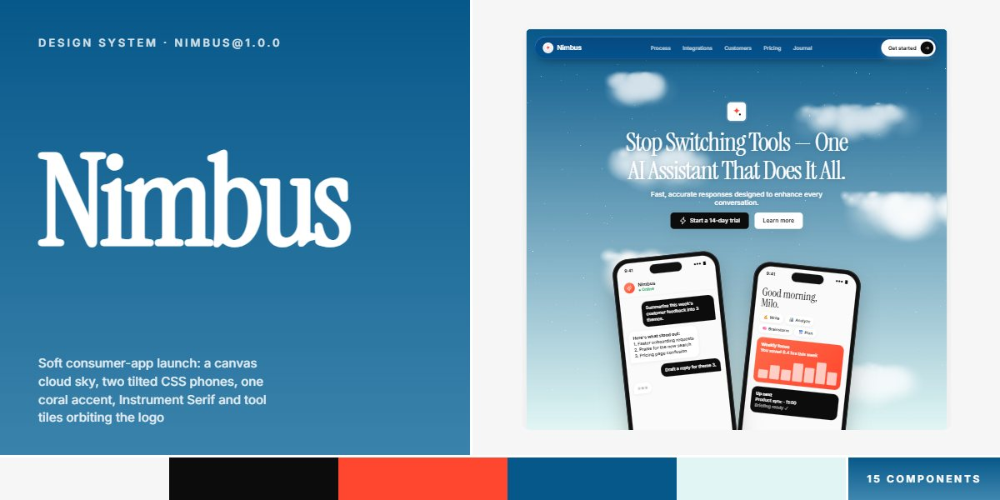

# Nimbus · design system

`nimbus@1.0.0` · 15 components · 74 tokens · light

The mainstream consumer-app launch look, for AI assistants, copilots and mobile-first products: a pale grey page (#F6F6F6) of white 22px cards with a whisper of shadow, ink type and exactly one coral accent (#FF462E) that arrives as 8% and 16% tints on the small tag above every section title and as a soft wash on primary cards. Headings are Instrument Serif 400 set tight (-.03em) over Inter 500. Its signature is the sky: a deep-blue-to-mint gradient (#07588A to #E1F6F4) with clouds drawn on canvas from one radial puff, spread by best-candidate sampling, drifting and parallaxing with scroll, behind a white serif headline and two phones tilted ±6° and cropped by the card's edge, their chat and home screens built from the system's own bubbles, chips and charts. A dark glass pill nav (blur, gradient rim, sliding highlight, white CTA with a turning arrow disc) sits over it. Darker moments are near-black panels: the integrations orbit (a white hub, three counter-spinning rings with comets carrying glass tool tiles that glow in their brand colour), the ink pricing card and a footer the sky CTA floats over, ending in a giant fading italic wordmark. Extracted from the Nimbus AI Assistant page.

The full board, every component at once: [preview.jpg](preview.jpg)

**Explore it live:** [instalanding.ai/systems/nimbus](https://instalanding.ai/systems/nimbus) — every component rendered, a token playground and COPY FOR AGENT.

## Files

| File | What it is |
| --- | --- |
| [`specimen.html`](specimen.html) | Every component live in one file. Each is a `<section data-component>`; the markup inside `.sp-demo` is the component. Opens from disk. |
| [`tokens.css`](tokens.css) | The design tokens as CSS custom properties (`--nb-*`). |
| [`nimbus.css`](nimbus.css) | Tokens plus every component's CSS, scoped under `.nb` with `nb-` class names, so it can't restyle anything else on your page. |

## Use it

1. Load the fonts: `<link rel="stylesheet" href="https://fonts.googleapis.com/css2?family=Instrument+Serif:ital@0;1&family=Inter:wght@400;500;600;700&display=swap">`
2. Link `nimbus.css` and wrap the part of your page that uses the system in `
`.
3. Copy components from `specimen.html`. Interactive ones need the small script in its `<script id="nb-components-js">`, and any that draw SVG art need its `<svg id="nb-defs">`.
4. Change the look by editing the tokens, not the components.

## Components

- Glass pill nav
- Buttons, pills & tags
- Serif display & coral tags
- Cloud sky
- Sky hero & phones
- Phone mockups
- Process carousel
- Logo ticker
- Integrations orbit
- Section head & stats
- Quote masonry
- Plans & billing switch
- Journal posts
- FAQ accordion
- Sky CTA & footer

## Conventions

**Typography**

- Two faces: Instrument Serif 400 (--nb-font-serif) for h1, h2, prices, stats, the menu, the footer tagline and the wordmark; Inter (--nb-font-sans) for everything else at weight 500, with 600 for names, tags and pill labels. h3 and h4 stay in Inter (500).
- Display type is tight: -.03em on h1 and h2, line height 1.1 on h1 and 1 on h2. Sizes are tokens that step down at 1199 and 809px: --nb-h1 / --nb-h1-tablet / --nb-h1-phone, --nb-h2 / -tablet / -phone, --nb-display-int for the dark panel's h2, --nb-price, --nb-tagline.
- Italic serif is the one emphasis: the orbit panel's last words in a coral gradient italic (em inside .nb-int h2), the footer tagline's frost italic, the giant italic wordmark. Body copy is grey (.nb-grey) at 16px or .nb-lead at 19px; keep paragraphs under about 500px.

**Colour**

- The page is --nb-bg with --nb-white cards and --nb-ink type; secondary text is --nb-grey and hairlines are --nb-line. Coral (--nb-accent) is the only accent and almost never a flat fill: it arrives as --nb-accent-08 and --nb-accent-16 on tags, as --nb-accent-soft washing primary cards and open FAQ rows, and on small marks (the logo star, chart lines, the send dot, the weekly card).
- Every section title sits under a .nb-tag: an icon from the sprite plus a word, coral on its 8% tint with a 16% rim. .nb-tag.nb-plain is the grey label tag inside cards; .nb-tag.nb-dark is the glass one on night panels.
- Blue only lives in the sky: --nb-sky (--nb-sky-top to --nb-sky-bottom) behind the hero and the CTA, with white type carrying a soft blue text shadow. The dark moments are --nb-night panels (integrations, footer) and the ink plan or quote card; status green is --nb-live, metric deltas are --nb-up.

**Sky & phones**

- A sky is 
<canvas></canvas>
 as the first child of a positioned, rounded container (.nb-hero-card, .nb-cta-card); the component script draws its clouds and reads both colours from the tokens. Put content after it; the gradient behind the canvas is the fallback.
- Phones are .nb-phone (.nb-left or .nb-right) inside .nb-phones, which crops them at its bottom edge; each holds a .nb-screen with a .nb-notch, a .nb-status bar and app UI built from the system's parts (.nb-b.nb-me / .nb-b.nb-ai bubbles, .nb-chip, .nb-mini-card with .nb-bars). They tilt by --nb-tilt; keep the left one in front.
- Never use screenshots or image files: phones, app slides, logos, portraits (.nb-portrait, a gradient square) and journal art are CSS and inline SVG.

**Cards, buttons & forms**

- Cards are --nb-r-card white blocks with a 1px --nb-bg border and --nb-shadow, laid out on --nb-gap gaps. Variants: .nb-primary (white to --nb-accent-soft with a 16% coral rim) and .nb-dark (ink, white type). Dark showcase panels use --nb-r-panel; the footer --nb-r-footer; the sky CTA --nb-r-sheet.
- On light surfaces buttons are --nb-r blocks: .nb-btn.nb-btn-dark (ink, optionally an icon first) and .nb-btn.nb-btn-light, lifting 2px on hover. On dark surfaces the action is .nb-nav-cta, a white pill with a black .nb-arr disc that turns -45deg on hover, beside a glass ghost pill (.nb-int-ghost).
- Switches are .nb-toggle with role="switch" and aria-checked; in a .nb-price-grid one switch flips every .nb-pcard (data-nb-price holds the monthly price, annual is 15% off). The newsletter is a .nb-news-form pill with data-nb-news and an .example placeholder; it sends nothing.

**Motion**

- Everything that responds eases on --nb-ease: the nav highlight and pill over --nb-dur, slides over --nb-dur-slide, button lifts over --nb-dur-quick. The process carousel advances every --nb-dur-carousel while on screen and its panel's colour spots drift over --nb-dur-drift.
- Ambient loops are slow: clouds drift and parallax with damping, the ticker scrolls over --nb-dur-ticker, orbit rings turn over --nb-orbit-1, -2 and -3 in alternating directions while their tiles counter-rotate; hovering the panel pauses the orbit. Canvas skies and the carousel only run while on screen.
- Under prefers-reduced-motion all CSS animation and transitions stop, the sky draws once, the carousel waits for a click and the journal's SVG art is paused.

**Accessibility**

- Skies, the dot grid, the wordmark and the ticker's second copy are aria-hidden; the phone pair and the orbit are role="img" with an aria-label that says what they show.
- The menu button reports aria-expanded and swaps its label; Escape closes it. Carousel buttons have aria-labels and hidden slides are aria-hidden. FAQ questions are role="button" with tabindex and aria-expanded, and open with Enter or Space.
- White type over the sky always keeps the soft text shadow and sits in the upper, darker half of the gradient; never put small grey copy on the sky.

## Extracted from

- [Nimbus AI Assistant Page](../../pages/nimbus-ai-assistant-page) · [live](https://instalanding.ai/demos/nimbus-ai-assistant.html)

Every system is extracted from a real, working page: the components are its markup, not a redraw.

MIT.
