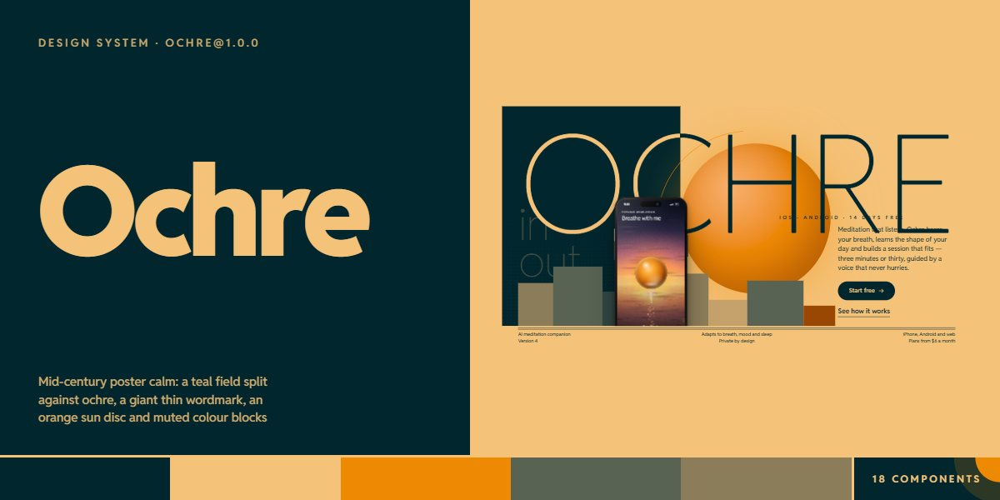

# Ochre · design system

`ochre@1.0.0` · 18 components · 49 tokens · light

A warm, mid-century poster language for wellness, meditation, health and calm consumer AI: a deep teal field split against ochre paper, a huge thin Reddit Sans wordmark that changes from paper to ink at the split, an orange sun disc with a hairline orbit arc, and skylines of muted sage, khaki and rust colour blocks. Dark teal pill buttons wipe to sun on hover, text links are underlined with a rule that redraws, and ruled strips (double ink rules over three columns) frame the page. Phones drawn in CSS hold app screens with a glass breathing orb over landscapes painted in code (dawn lake, ocean at dusk, desert night, forest rain, northern lights, valley fog, moonlit water); price pillars rise with their prices, a teal disc cuts the trial title, and a split timeline runs through the day. Extracted from the Ochre AI Meditation App page.

The full board, every component at once: [preview.jpg](preview.jpg)

**Explore it live:** [instalanding.ai/systems/ochre](https://instalanding.ai/systems/ochre) — every component rendered, a token playground and COPY FOR AGENT.

## Files

| File | What it is |
| --- | --- |
| [`specimen.html`](specimen.html) | Every component live in one file. Each is a `<section data-component>`; the markup inside `.sp-demo` is the component. Opens from disk. |
| [`tokens.css`](tokens.css) | The design tokens as CSS custom properties (`--oh-*`). |
| [`ochre.css`](ochre.css) | Tokens plus every component's CSS, scoped under `.oh` with `oh-` class names, so it can't restyle anything else on your page. |

## Use it

1. Load the fonts: `<link rel="stylesheet" href="https://fonts.googleapis.com/css2?family=Reddit+Sans:ital,wght@0,200..900;1,200..900&display=swap">`
2. Link `ochre.css` and wrap the part of your page that uses the system in `
`.
3. Copy components from `specimen.html`. Interactive ones need the small script in its `<script id="oh-components-js">`, and any that draw SVG art need its `<svg id="oh-defs">`.
4. Change the look by editing the tokens, not the components.

## Components

- Header
- Buttons & links
- Type & wordmark
- Poster hero
- Ticker band
- Manifesto & figures
- Ruled feature rows
- Phones & breathing orb
- Soundscape cards
- Night window
- Day timeline
- Price pillars
- App collage
- Quote cards
- Disc call to action
- FAQ
- Contact & signup
- Ruled footer

## Conventions

**Typography**

- One family, Reddit Sans, set thin and huge. Display heads (.oh-h2) are 200 at --oh-display with -.035em tracking and line-height .94; numerals, hours and in/out are weight 100 (--oh-numeral, --oh-date); h3s, quotes, row and slot titles are 300. Never set display type bold.
- The wordmark (.oh-wm) fills its container exactly: font-size calc((100cqi - 2 * --oh-gut) / --oh-len / .64) on a container-type: inline-size parent, where --oh-len is the letter count. Inside a split it is coloured by a background-clip text gradient that changes at --oh-split.
- Labels (.oh-tracked) are 600 at --oh-label with .42em tracking in capitals; meta lines are 600 at --oh-meta, .05em, capitals. Leads are --oh-lead, line-height 1.42; body is --oh-text, line-height 1.5.

**Color & composition**

- Two fields: ochre paper (--oh-paper) and deep teal (--oh-ink), meeting on a hard vertical split (the hero at 38%, the day timeline at 34%); text crossing the split changes colour with it. Sun (--oh-sun) is the one hot colour: the disc, bands, dots, the current hour and the hover wipe.
- Sage, khaki and rust (--oh-sage, --oh-khaki, --oh-rust) only appear as flat colour blocks: the pillar skylines (.oh-pillar with --oh-w, --oh-h, --oh-c), price pillars and collage bars. Secondary text uses the oklab mixes --oh-soft-on-paper, --oh-soft-on-ink and --oh-dim-on-ink; never add new greys.
- Suns are radial gradients from a pale highlight through --oh-sun to rust, often with a hairline orbit arc (an SVG circle, stroke-width .22, dashed with pathLength 100). The page lays --oh-grain over everything at 8% multiply.

**Shapes & pictures**

- No rounded cards: blocks are square-cornered. Only pills (--oh-pill), circles, arch tops (pill radius on the two top corners: soundscape frames, collage shots) and the frosted glass cards on pictures (--oh-r-glass, --oh-glass) are round.
- Structure is ruled: 1px ink rules (--oh-rule) between rows and a double rule (two 1px lines --oh-rule-double apart) over the hero's three-column strip and the footer columns.
- Pictures are drawn in code: <canvas class="oh-scene" data-oh-scene="dawn|ocean|desert|forest|aurora|fog|night"> painted by the component script, phones as .oh-phone with .oh-phone__body / __screen / __ui markup, the breathing orb as  sized by --oh-d. Never use image files.
- Buttons: .oh-btn (teal), .oh-btn--sun, .oh-btn--paper (on teal); .oh-link for underlined text links; .oh-ibtn for hairline ring icons. Sections use .oh-dark for teal panels and .oh-wrap for the --oh-maxw column.

**Motion**

- Everything eases on --oh-ease (cubic-bezier(.2,.7,.1,1)). Pills wipe the opposite colour in from the left over --oh-dur-wipe and the arrow slides 4px; link underlines redraw over --oh-dur-line; ring buttons fill with sun from below; feature rows flood teal from the bottom over --oh-dur-row and their pictures zoom.
- Ambient loops are slow: the orb breathes on a --oh-breath (10s) cycle with fading in / hold / out cues, the ticker scrolls on --oh-tick, ripples spread, the candle flickers, and rain and snow fall on their scenes only while on screen.
- With prefers-reduced-motion every loop stops, one still frame of each scene is painted, and every component is complete without motion.

**Accessibility**

- Decorative suns, pillars, arcs and phones are aria-hidden; a picture that carries meaning gets role="img" and an aria-label (scene canvases, the hero phone's figure). The wordmark h1 keeps its full phrase in an .oh-sr-only span.
- The burger has aria-controls, aria-expanded and a label that swaps between open and close, and Escape closes the sheet; FAQ rows are native details and summary; the signup reports through a role=status line.
- Body text stays at --oh-ink on paper and sun, --oh-paper on teal; soft text uses the soft-on mixes, never the dim one.

## Extracted from

- [Ochre AI Meditation App Page](../../pages/ochre-ai-meditation-app-page) · [live](https://instalanding.ai/demos/ochre-meditation.html)

Every system is extracted from a real, working page: the components are its markup, not a redraw.

MIT.
