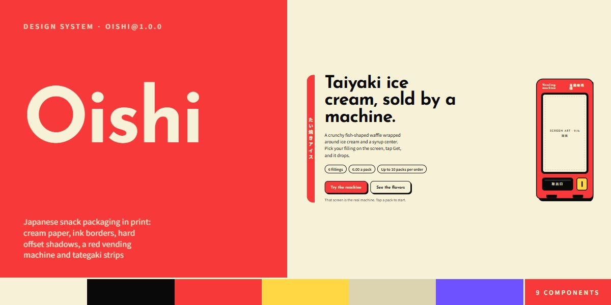

# Oishi · design system

`oishi@1.0.0` · 9 components · 55 tokens · light

A print-shop language for food, snack and kiosk products, lifted from Japanese packaging: a cream (#F7F1D7) page, ink (#09090A) everywhere as 2.5-3px borders, and shadows that are flat offset blocks with no blur (4px 4px 0 on buttons, 10px 10px 0 on the cabinet). One red (#F73939) carries the main button, the vertical tategaki strip set top to bottom in Noto Sans JP 900, and the vending-machine cabinet with its black bezel, pickup slot (取出口), yolk coin slot and feet. Josefin Sans sets the display type big and tight; every Japanese word is Noto Sans JP. Six flavor colours drive one accent, --oi-flavor, which recolours a card's hard shadow and underline when a pack button is chosen. The page's art was Rive canvases; the system leaves honest art slots of the same proportions for your own. Extracted from the Oishi taiyaki ice cream page.

The full board, every component at once: [preview.jpg](preview.jpg)

**Explore it live:** [instalanding.ai/systems/oishi](https://instalanding.ai/systems/oishi) — every component rendered, a token playground and COPY FOR AGENT.

## Files

| File | What it is |
| --- | --- |
| [`specimen.html`](specimen.html) | Every component live in one file. Each is a `<section data-component>`; the markup inside `.sp-demo` is the component. Opens from disk. |
| [`tokens.css`](tokens.css) | The design tokens as CSS custom properties (`--oi-*`). |
| [`oishi.css`](oishi.css) | Tokens plus every component's CSS, scoped under `.oi` with `oi-` class names, so it can't restyle anything else on your page. |

## Use it

1. Load the fonts: `<link rel="stylesheet" href="https://fonts.googleapis.com/css2?family=Josefin+Sans:wght@400;600;700&family=Noto+Sans+JP:wght@400;500;700;900&display=swap">`
2. Link `oishi.css` and wrap the part of your page that uses the system in `
`.
3. Copy components from `specimen.html`. Interactive ones need the small script in its `<script id="oi-components-js">`.
4. Change the look by editing the tokens, not the components.

## Components

- Buttons & fact pills
- Tategaki bar
- Header & wordmark
- Hero & cabinet
- Vending-machine cabinet
- Flavor picker & card
- Numbered steps
- Skewed ink band
- Footer wordmark

## Conventions

**Typography**

- Josefin Sans (--oi-font-display) at 700 sets every heading and button, big and tight: the hero h1 at --oi-h1 (.96 line height, -.025em), h2 at --oi-h2, the footer wordmark at --oi-wordmark (.8 line height, -.04em). Josefin sits high in its box, so buttons pad 1em on top and .85em below.
- Noto Sans JP (--oi-font-body) carries body copy (--oi-body, 1.6 line height) and every Japanese word, always at weight 900 (.oi-jp) and always with lang="ja". Pair English with its Japanese: the wordmark with おいしい in red, each flavor with its name, each step with its label (味を選ぶ).
- Quiet copy is --oi-ink-muted (hints, legal) or --oi-ink-soft (Japanese sub-labels); on the ink band it is --oi-cream-dim.

**Ink, paper & shadows**

- Everything sits on --oi-cream and is outlined in --oi-ink: --oi-border (3px) for cards, the cabinet and section rules, --oi-border-btn (2.5px) for buttons and packs, --oi-border-pill (2px) for fact pills and the nav underline.
- Shadows are hard offsets with no blur, in ink: --oi-shadow-btn on buttons, --oi-shadow-lift on hover (moved -1px,-1px), --oi-shadow-press when pressed (moved 3px,3px), --oi-shadow-cabinet on the machine. On the ink band they flip to cream (--oi-shadow-btn-on-ink). Never add blur or soft drop shadows.
- Red (--oi-red) is the machine and the main action: one .oi-btn.oi-primary per group, the cabinet, the tategaki bars, the third step counter and the Japanese kickers. Yolk (--oi-yolk) is the coin slot and the button on the ink band. Tan (--oi-tan-2) grounds cards and hovered packs.

**Flavor accent**

- Each flavor has a token (--oi-flavor-red-beans, -blueberry, -green-tea, -bubblegum, -chocolate, -peach). --oi-flavor is the current one; the card's shadow (--oi-shadow-card-offset in --oi-flavor) and the Japanese name's --oi-underline follow it.
- Pack buttons are <button class="oi-pack" aria-pressed data-oi-flavor="green-tea" data-oi-fill="…"> inside .oi-packs. The component script sets aria-pressed, sets --oi-flavor on the nearest .oi-flavors (or .oi), fills [data-oi-fl="name|jp|fill"] in that scope and dispatches an oi:flavor event ({ flavor, index }) for your own art.

**Cabinet & art slots**

- The vending machine is .oi-cabinet: .oi-cap (English left, Japanese right), .oi-screen (the black bezel), .oi-tray with the .oi-slot pickup (取出口) and the .oi-coin slot, then .oi-feet. Its height is --oi-cab-h (min(80vh, 840px)) and its width half of that; under 820px it takes min(100%, 440px).
- The page's art was canvases; here every one is an .oi-art slot of the same size and aspect ratio (screen 9:16, pack 1185:766, flavor card 959:600, mascot and band character 1:1) with a dashed outline and a label. Replace the slot's contents with your own <canvas>, <video>,  or SVG and keep its sizing class; pack slots are tinted with their flavor colour.
- The tategaki bar (.oi-bar) is Japanese only, writing-mode: vertical-rl with text-orientation: upright, cream on red, aria-hidden. It stretches beside the hero copy and the footer wordmark and hides on narrow screens.

**Motion**

- Motion is mechanical and short: buttons press in --oi-dur-press, packs change ground in --oi-dur-hover, the flavor accent crossfades in --oi-dur-flavor, all on --oi-ease. Nothing loops or floats in the CSS.
- The ink band is skewed by --oi-band-skew and its content skewed back by the same amount, so the copy stays straight.

**Accessibility**

- Focus is a 3px ink outline offset 3px (2px on packs). Packs are real buttons with aria-pressed; the flavor card's text sits in an aria-live="polite" region.
- Art slots and tategaki bars are aria-hidden; when you put interactive art in a slot (like the page's playable machine screen), make it focusable and give it an aria-label.
- Cream text only sits on red or ink; the yolk button keeps ink text.

## Extracted from

- [Oishi Taiyaki Ice Cream Page](../../pages/oishi-taiyaki-ice-cream-page) · [live](https://instalanding.ai/demos/oishi-taiyaki-ice-cream.html)

Every system is extracted from a real, working page: the components are its markup, not a redraw.

MIT.
