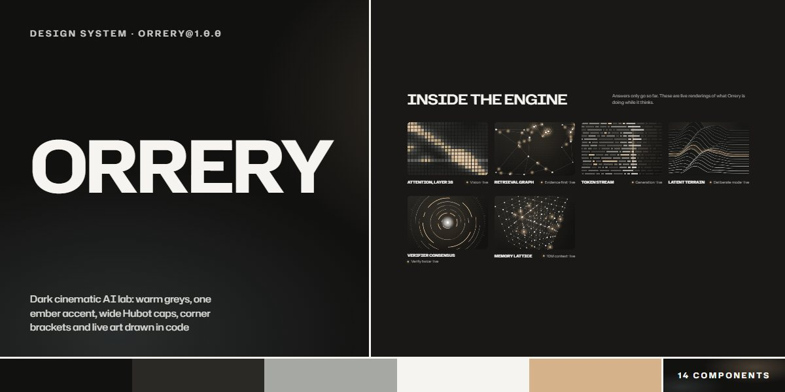

# Orrery · design system

`orrery@1.0.0` · 14 components · 47 tokens · dark

Warm greys under grain, a single ember accent, Hubot Sans set wide and uppercase over Instrument Sans, corner brackets that frame whatever matters, and every picture drawn in code: an orrery with planets and lens flares, a search tree that commits, a memory sphere, agents that ask first, live renderings and scan-line portraits. Sections switch between dark and light tones and every component follows. Extracted from the Orrery Reasoning Engine page.

The full board, every component at once: [preview.jpg](preview.jpg)

**Explore it live:** [instalanding.ai/systems/orrery](https://instalanding.ai/systems/orrery) — every component rendered, a token playground and COPY FOR AGENT.

## Files

| File | What it is |
| --- | --- |
| [`specimen.html`](specimen.html) | Every component live in one file. Each is a `<section data-component>`; the markup inside `.sp-demo` is the component. Opens from disk. |
| [`tokens.css`](tokens.css) | The design tokens as CSS custom properties (`--or-*`). |
| [`orrery.css`](orrery.css) | Tokens plus every component's CSS, scoped under `.or` with `or-` class names, so it can't restyle anything else on your page. |

## Use it

1. Load the fonts: `<link rel="stylesheet" href="https://fonts.googleapis.com/css2?family=Hubot+Sans:wdth,wght@100..125,500..700&family=Instrument+Sans:wght@400..700&display=swap">`
2. Link `orrery.css` and wrap the part of your page that uses the system in `
`.
3. Copy components from `specimen.html`. Interactive ones need the small script in its `<script id="or-components-js">`, and any that draw SVG art need its `<svg id="or-defs">`.
4. Change the look by editing the tokens, not the components.

## Components

- Navigation
- Buttons & links
- Headline pairing
- Hero window
- Capability rows
- Method steps
- Live renderings
- Outcomes & sources
- Team portraits
- Voice cards
- Pricing tiers
- FAQ
- Contact
- Footer

## Conventions

**Typography**

- Heads are Hubot Sans 600, uppercase, font-stretch 112% (.or-h2, --or-display), line-height .96; the hero words, figures and prices go to 125% and size from their character count (--or-len), so update --or-len with the text.
- Labels are wide-tracked caps: .or-caps (Hubot 700 at 14-17px) for titles and names, .or-spaced (letter-spacing .38em, 13px) for kickers. Body is Instrument Sans 17px; ledes use --or-fg2 and stop at 46ch.
- Numbers and versions take the ember (--or-ember); everything else stays in the greys.

**Layout**

- Content sits in .or-wrap (1400px, gutter --or-pad); sections open with --or-sec of space and a two-part head (a wide caps h2 left, the lede and a link right) that stacks under 860px.
- Tone is per section: data-or-tone="dark" or "light" sets --or-fg, --or-fg2, --or-bg and --or-line, and every component inside reads those, so the same button or link works on both grounds. Alternate tones down the page.
- Rows and lists are ruled with --or-line hairlines; pictures sit in .or-slot boxes with a grain overlay and the --or-r radius.

**Brackets & art**

- Corner brackets mark what matters: .or-bracket.or-bracket--tr / --bl (size --or-bk) around the hero window, the key price tier and the form; .or-framed draws them with pseudo-elements on any box.
- Pictures are code: <canvas data-or-art="orrery|deliberate|memory|agents|vision|deploy|grid|graph|stream|terrain|rings|lattice|portrait" data-or-seed="n"> inside a sized box. The seed fixes the composition; canvases animate only while on screen.
- Texture comes from two noise tokens: --or-grain as an overlay on dark surfaces and --or-frost as a veil on glass. Never a flat dark panel without grain.

**Motion**

- Everything eases on --or-ease (cubic-bezier(.19,1,.22,1)). The solid button fills with ember from the middle out, the link's underline is swept by a 2px rule, icon buttons grow corner brackets, all over --or-dur to --or-dur-fill.
- The art carries the motion: slow orbits, scans and pulses in the canvases; the orrery follows the pointer slightly.
- With prefers-reduced-motion every canvas is drawn once and transitions are off.

**Accessibility**

- Meaningful canvases have role="img" and an aria-label describing what they show; decorative ones are aria-hidden.
- The menu button carries aria-expanded and swaps its label; billing options are buttons with aria-pressed; questions are buttons with aria-expanded.
- Forms use real labels, a polite live status line, and the ember focus ring (2px, offset 3px) on every control.

## Extracted from

- [Orrery Reasoning Engine Page](../../pages/orrery-reasoning-engine-page) · [live](https://instalanding.ai/demos/orrery-engine.html)

Every system is extracted from a real, working page: the components are its markup, not a redraw.

MIT.
