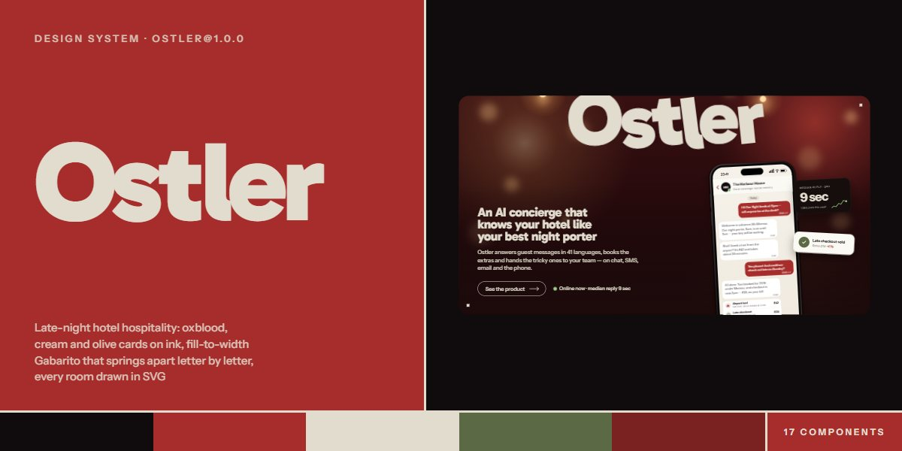

# Ostler · design system

`ostler@1.0.0` · 17 components · 80 tokens · dark

A warm, dark hospitality language for hotels, restaurants, travel and AI concierge or support products: an ink page (#100C0D) of rounded cards inset by a small gap, coloured oxblood red (#A72D2D), cream (#E2DCCE) or olive (#5B6A45), each with two small square corner marks. Display words are Gabarito 900 at line-height .8, sized to fill their box exactly (font-size = 100cqi / (letters x .52)), and every letter stands at its own slight tilt from a seeded stance; headings are Gabarito 800, copy is Instrument Sans. Pill buttons fill from the arrow end in a growing circle and tilt -3deg on a spring; links turn wavy; a 6% film grain sits over the page. The pictures are all inline SVG: a blurred lobby at night behind a guest's phone with a full concierge chat, module mockups, a weekly dashboard, a hotel facade with lit windows, a reception desk with key boxes and a brass bell, six tilted hotel prints. The signature is scroll: the hero's giant "Ostler" springs into its stance and rocks, then flies apart letter by letter as the card shrinks and tilts; "Awake" is knocked out of an ink layer and zooms 9x into the hotel; module covers tilt as they cross a sideways rail; step cards stack and tilt away; prints drift at their own speeds; words bounce in and letters drop elastically. The page's GSAP choreography is rebuilt as CSS driven by scroll progress a small script writes, with no libraries. Extracted from the Ostler AI hotel concierge page.

The full board, every component at once: [preview.jpg](preview.jpg)

**Explore it live:** [instalanding.ai/systems/ostler](https://instalanding.ai/systems/ostler) — every component rendered, a token playground and COPY FOR AGENT.

## Files

| File | What it is |
| --- | --- |
| [`specimen.html`](specimen.html) | Every component live in one file. Each is a `<section data-component>`; the markup inside `.sp-demo` is the component. Opens from disk. |
| [`tokens.css`](tokens.css) | The design tokens as CSS custom properties (`--os-*`). |
| [`ostler.css`](ostler.css) | Tokens plus every component's CSS, scoped under `.os` with `os-` class names, so it can't restyle anything else on your page. |

## Use it

1. Load the fonts: `<link rel="stylesheet" href="https://fonts.googleapis.com/css2?family=Gabarito:wght@500..900&family=Instrument+Sans:ital,wght@0,400..700;1,400..700&display=swap">`
2. Link `ostler.css` and wrap the part of your page that uses the system in `
`.
3. Copy components from `specimen.html`. Interactive ones need the small script in its `<script id="os-components-js">`, and any that draw SVG art need its `<svg id="os-defs">`.
4. Change the look by editing the tokens, not the components.

## Components

- Header bar & menu
- Pill buttons, links & icon buttons
- Fill-type, headings & labels
- Section cards & corner marks
- Springing hero & guest phone
- Claim ticker & hotel names
- Story card, print & stats
- Module covers rail
- Per-room price list
- Knockout statement
- Sticky step cards
- Changelog rows
- Quote marquee
- Tilted prints & dropped letters
- FAQ rows
- Contact card & demo form
- Footer & wordmark

## Conventions

**Typography**

- Gabarito is the display face (--os-font-display), Instrument Sans carries everything else (--os-font-text). Display words are .os-display: Gabarito 900, line-height .8, -0.045em.
- Big words fill their box exactly: wrap the word in a .os-fillbox (a size container) and give it .os-fill and --os-len set to its letter count (spaces count); font-size is 100cqi / (--os-len x --os-k). Change --os-len with the word. Fill words hang from the top or sit on the bottom edge of their card, clipped, rather than floating in the middle.
- Letters of a fill word stand slightly tilted, each at its own angle: split them into  (rotation within ±8deg, lift within ±7%) and put the word in aria-label on the heading. data-os-bounce="still" holds the stance; "drop" also gives each letter --os-r0 and a --os-d delay so it falls into place.
- Headings are Gabarito 800 (.os-h2 at --os-h2, .os-h3 at --os-h3, rows at --os-row), tight (-0.02 to -0.035em) and balanced. Copy is Instrument Sans at --os-body; .os-lead is 500 at --os-lead; .os-muted drops to 72% of the current colour. Labels (.os-eyebrow) are 600 at --os-label, +0.14em, uppercase. Stats, prices and day numbers are Gabarito 900.

**Colour**

- The page is --os-ink with cream text. Colour arrives in whole cards: .os-on-red (red, cream text), .os-on-cream (cream, ink text) and .os-on-olive (olive, cream text). Alternate them down the page and never put two of the same colour next to each other.
- Lines and quiet text are derived from currentColor (--os-line at 26%, --os-muted at 72%), so they follow whatever card they are on; do not hard-code a line colour.
- --os-red-deep is for the depths (gallery prints, the form panel mixed 70% into red); the lobby tones (--os-lobby, --os-lobby-deep) only sit behind the hero. The one green is --os-online, for a live dot. No other hues, except inside the SVG pictures, which carry their own warm palette (lamp glow, brass, wood, linen).

**Cards & pictures**

- A section is a .os-card: radius --os-radius, padding --os-pad, inset by --os-gap from the page edge and --os-gap from the next card. Add .os-marks for the two --os-mark squares (top right, bottom left) in the card's text colour.
- Pictures are inline SVG in a .os-print frame (radius --os-radius-print, its field colour from .os-print--olive or --cream), the SVG as .os-art with role="img" and an aria-label. They use the shared filters and gradients in #os-defs (url(#os-sh), url(#os-bl14), url(#os-glowW), url(#os-brass) ...); never ship image files.
- Prints are tilted a few degrees and cast long soft shadows (--os-shadow-print, --os-shadow-cover, --os-shadow-shot); captions on prints are glass pills (--os-glass with a blur).

**Buttons & forms**

- One button: .os-btn, a 1.5px outlined pill in the current colour with the drawn arrow (.os-btn__arrow). On hover a circle of --os-btn-fill grows from the arrow end, the pill tilts -3deg on --os-spring and the arrow nudges right. .os-btn--solid starts filled cream (ink on cream cards) and fills red.
- Text links are .os-link: a --os-line underline that turns wavy and full-colour on hover or focus. Round icon buttons (.os-icon-btn) wobble on hover.
- Forms sit in a deeper-red panel with underline-only fields (.os-field) whose rule turns cream on focus, a solid pill to submit and a polite live status that thanks inline. Use .example addresses in demos.

**Motion**

- Springs, not slides: hover and toggles use --os-spring; letters land on --os-elastic and words and tags on --os-back (both linear() curves sampled from the page's GSAP easings). Reveals use data-os-reveal="up|tag|wipe|drop", data-os-split (words bounce in), data-os-rule (rules draw) and data-os-bounce="drop".
- Scroll drives the big moves; the component script writes progress and CSS maps it: the hero card (--os-p) shrinks and tilts while its letters fly off, the statement's knockout word zooms 9x (--os-z), step cards scale and tilt away as the next arrives (--os-s), prints drift at data-os-speed, pictures with data-os-parallax drift in their frames, and rail covers tilt as they cross (--os-tilt). Nothing pins.
- The hero word's letters are an outer .os-hero__ch (scroll) and an inner .os-hero__chi (spring and rock) so the two never fight. Loops are slow (ticker over --os-dur-ticker, quotes over --os-dur-voice per card, the lobby breathing over --os-dur-breathe) and pause off screen; the quote row eases to a stop on hover or focus.
- Under prefers-reduced-motion nothing is armed or written: no scroll moves, reveals, rocking, ticker, marquee or grain animation, and every word and card shows as written.

**Accessibility**

- Split words keep their text in aria-label and hide the letter spans; the ticker is aria-hidden; marquee clones are aria-hidden with their links untabbable.
- The menu button carries aria-expanded and swaps its label (data-os-open / data-os-close); Escape closes it. FAQ rows are details/summary. Focus rings are a 2px currentColor outline on everything.
- Small copy sits on flat card colour, never on the busy parts of a picture; cream on red and ink on cream both pass for body text. Keep copy in the cards readable at 390px (cards go single-column under 860px).

## Extracted from

- [Ostler AI Hotel Concierge Page](../../pages/ostler-ai-hotel-concierge-page) · [live](https://instalanding.ai/demos/ostler-hotel-concierge.html)

Every system is extracted from a real, working page: the components are its markup, not a redraw.

MIT.
