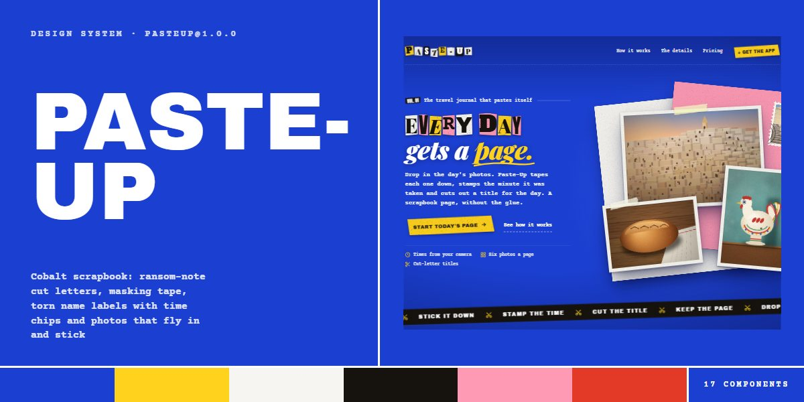

# Paste-Up · design system

`pasteup@1.0.0` · 17 components · 79 tokens · dark

A collage language for photo, travel, journaling and playful consumer apps: a cobalt ground (#1B3FD0) under a scanned paper grain, with everything on it cut from paper. Titles are never set, they are cut out: each letter is its own scrap in one of six display faces (Anton, Alfa Slab One, Abril Fatface, Archivo Black, Playfair Display italic, Courier Prime) on paper, yellow (#FFD21E), pink (#FF9AB5), red (#E23A26) or ink (#16130F), with its own torn clip-path edge, tilt and offset, so a heading reads like a ransom note. Surfaces are rag-edged paper scraps under the same fibre texture, pinned with three strips of masking tape and casting their shadows by their outline (drop-shadow filters, never box shadows). Photos are named, not captioned: a black Anton time chip tucked over a torn-paper strip with the name in Courier Prime. Buttons are tilted yellow scraps with Archivo Black capitals; a perforated stamp carries a rubber postmark; a black tape marquee runs across the hero at -1.6deg. The signature is motion in CSS alone: in the hero collage two loose sheets, white and pink, settle onto parallax layers, three bordered photo prints fly in from off the page on individual translate, rotate and scale keyframes, their tape sticks a beat later, the stamp drops in last, and the hero's cut letters land one by one. Extracted from the Paste-Up travel journal page; its textures ship as image files beside the CSS.

The full board, every component at once: [preview.jpg](preview.jpg)

**Explore it live:** [instalanding.ai/systems/pasteup](https://instalanding.ai/systems/pasteup) — every component rendered, a token playground and COPY FOR AGENT.

## Files

| File | What it is |
| --- | --- |
| [`specimen.html`](specimen.html) | Every component live in one file. Each is a `<section data-component>`; the markup inside `.sp-demo` is the component. Opens from disk. |
| [`tokens.css`](tokens.css) | The design tokens as CSS custom properties (`--pu-*`). |
| [`pasteup.css`](pasteup.css) | Tokens plus every component's CSS, scoped under `.pu` with `pu-` class names, so it can't restyle anything else on your page. |

## Use it

1. Load the fonts: `<link rel="stylesheet" href="https://fonts.googleapis.com/css2?family=Abril+Fatface&family=Alfa+Slab+One&family=Anton&family=Archivo+Black&family=Courier+Prime:wght@700&family=Playfair+Display:ital,wght@1,900&display=swap">`
2. Link `pasteup.css` and wrap the part of your page that uses the system in `
`.
3. Copy components from `specimen.html`. Interactive ones need the small script in its `<script id="pu-components-js">`.
4. Change the look by editing the tokens, not the components.

## Components

- Header & cut-letter wordmark
- Cut letters & ransom titles
- Tilted buttons & links
- Time chips & torn labels
- Paper scraps, tape & torn edges
- Taped photo prints
- Stamp & postmark
- Tape marquee
- Scissors cut line
- Paste-up collage
- Paste-up hero
- Taped step cards
- Detail cards
- Taped photo row
- Paper pricing
- Red cut-letter CTA
- Footer

## Conventions

**Typography**

- Display type is cut, not set. A cut letter is <i>A</i>: the span carries rotate and translate inline, and for section samples a fixed width and height too (so a late font never reflows them; the hero title's letters size to their glyph) and casts --pu-drop-scrap; the <i> carries background-color (paper, yellow, pink, red or ink), the face (one of --pu-font-anton, --pu-font-slab, --pu-font-fat, --pu-font-black, --pu-font-italic, --pu-font-body) and its colour (ink on light papers, white on red and ink). Cycle the edges .pu-e0 to .pu-e3 and vary face and paper so no two neighbours match; tilts stay within ±5deg and offsets within ±4px.
- Group a title's words in inline-flex spans (align-items: flex-end, gap 2px) inside a wrapping flex row, so words break as units. Put the hero title in .pu-hl and give each letter --pu-i (0, 1, 2…) to land them one by one. Section titles cut whole words instead: one padded scrap per word at --pu-h2-scrap with ±3deg tilts. Always give the h1/h2 its real text (the letters are real text, so it reads as words); aria-hide decorative cut titles that repeat nearby text.
- Courier Prime 700 (--pu-font-body) carries every sentence: the lead at --pu-lead, copy at --pu-body or --pu-copy, labels and links at --pu-label. Archivo Black capitals set card headings (--pu-h3, --pu-h3-card), button labels (.05em) and the marquee (.14em). Anton sets numbers: time chips, prices (--pu-price), counts. The italic Playfair line (.pu-serif) with its drawn yellow underline (.pu-uline) appears once, under the hero title.

**Colour & paper**

- The ground is the .pu root: --pu-cobalt under the scanned grain (tex-grain.jpg tiled at --pu-grain-size). The grain is a cobalt photograph, so --pu-cobalt recolours flat areas and anything without the texture; to change the ground's hue, swap the texture too. Text on the ground is white (copy at 82-92%, rules at 16-60% white dashes).
- Scraps are paper: .pu-ppr with background-color --pu-paper, --pu-yellow, --pu-pink or --pu-red, the fibre texture multiplied over it, a torn outline (.pu-rag, .pu-rag2, .pu-rag3), wrapped in a .pu-prt that casts --pu-drop-print. Copy on paper is --pu-ink-soft or --pu-ink-copy; on red it is white. Spent controls use --pu-spent with --pu-spent-ink.
- Shadows come from the cut outline, never from a box: use the Lift tokens (--pu-drop-scrap, --pu-drop-print, --pu-drop-label, --pu-drop-stamp) as filter on a wrapper around the clipped element (a clip-path would cut its own shadow off). Box shadows are only for the square hero pieces, the loose sheets (--pu-shadow-paper) and the photo prints (--pu-shadow-print), and the marquee. All shade is navy, rgb(var(--pu-shade) / alpha), never black.
- Textures are image files beside pasteup.css (tex-grain.jpg, tex-paper.png, tex-strip-1.png, tex-tape-1..3.png), named by relative url() in the component CSS: link the stylesheet from instalanding.ai, or copy the files next to your copy of it. Everything sits inside a .pu root, which is also the textured ground. The four photos (.pu-ph-sassi, -duomo, -pane, -cucu) are example content: give your own .pu-ph a background-image.

**Tape, labels & keepsakes**

- Tape is <i class="pu-tape pu-tape-1" aria-hidden="true"> (1 to 3) positioned absolutely across a scrap's top edge or a photo's corner, top about -11px, rotated 3-8deg (up to 42deg across a corner); 112×27 holds a large print. Vary the strip from one piece to the next.
- A photo print is .pu-print.pu-ppr: a .pu-ph inset 11px inside a --pu-print border, cast by --pu-shadow-print and held by one strip of tape. On a collage it is absolutely placed and tilted -6 to 5deg; loose sheets (.pu-paper.pu-ppr, white or pink) lie under the prints.
- Name every photo with a label, not a caption: <b class="pu-chip">07:12</b>Sassi at first light, tilted -5 to 4deg. .pu-nsh must keep will-change: filter (it ships in the CSS): without its own compositing layer Chrome sometimes repaints the torn strip but not the words on it, leaving blank labels. Do not remove it or move the drop-shadow onto the strip; give any new text-on-texture scrap under a drop-shadow filter the same.
- The stamp (.pu-stamp with its postmark SVG) sits on the collage at about 9deg and drops in last; counts (a cut numeral under an ink tab) label a set of photos. Divide sections with the scissors cut line.

**Buttons & links**

- A button is <a class="pu-btn" style="display:inline-block;text-decoration:none;rotate:-2deg"> around <i>: yellow paper, ink Archivo Black capitals at .05em, a leading + or a trailing arrow. Ink paper with white text is the second choice. Tilt every button -2 to -3deg; hover lifts it by --pu-hover-lift.
- Text links are Courier Prime 700: .pu-ghostlink on a 2px dashed white underline that turns yellow on hover, .pu-navlink plain at 86% white. Focus is a 3px white outline offset 6px.

**Motion**

- Motion is CSS keyframes on the individual translate, rotate and scale properties, so they never fight an element's own inline tilt. A print (.pu-print, its final place and tilt inline) gets --pu-dx, --pu-dy (where it comes from) and --pu-spin and lands over --pu-dur-print on --pu-ease-print; its tape (.pu-stick) sticks about 0.62s after the print's delay. Stagger prints about 0.35s apart.
- Elsewhere: .pu-rise with --pu-d for copy (--pu-dur-rise), cut letters land on --pu-ease-land, loose sheets settle with sheetin (--pu-dur-sheet), the stamp drops in on --pu-ease-stick, the underline draws on --pu-ease-draw, and the marquee loops over --pu-dur-marquee. Every entrance plays once; nothing loops but the marquee.
- The one script drifts a collage's .pu-layer elements with a fine pointer by their data-pu-depth (6-36). Under prefers-reduced-motion every animation finishes at once, the parallax is off and the underline shows drawn.

**Accessibility**

- Cut letters are real text in the heading. Decorative pieces (loose sheets, counts, samples in cards, tape, the postmark, the marquee, dividers) are aria-hidden; photos are role="img" with an aria-label that says what is in them.
- Tilted and textured text still needs contrast: ink on paper, yellow and pink; white on red, ink and cobalt. Never put white text on yellow or pink, and keep body copy off the textured ground at under 82% white.

## Extracted from

- [Paste-Up Travel Journal Page](../../pages/paste-up-travel-journal-page) · [live](https://instalanding.ai/demos/paste-up-travel-journal.html)

Every system is extracted from a real, working page: the components are its markup, not a redraw.

MIT.
