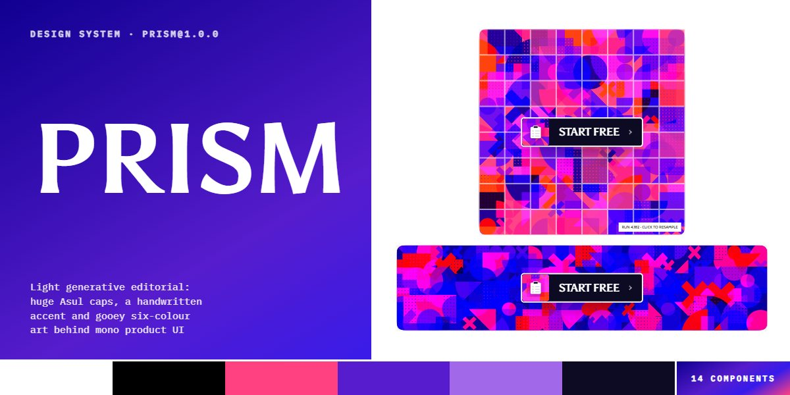

# Prism · design system

`prism@1.0.0` · 14 components · 74 tokens · light

Asul set huge and uppercase on white with one handwritten Covered By Your Grace note in hot pink, Cabin body, and IBM Plex Mono product slices on a deep indigo screen. Every picture is a generative gooey grid of six colours run through an SVG filter, and product cards sit on mats cut from that art with a label tab and a rotated status stamp. Extracted from the Generative Editorial Product landing page.

The full board, every component at once: [preview.jpg](preview.jpg)

**Explore it live:** [instalanding.ai/systems/prism](https://instalanding.ai/systems/prism) — every component rendered, a token playground and COPY FOR AGENT.

## Files

| File | What it is |
| --- | --- |
| [`specimen.html`](specimen.html) | Every component live in one file. Each is a `<section data-component>`; the markup inside `.sp-demo` is the component. Opens from disk. |
| [`tokens.css`](tokens.css) | The design tokens as CSS custom properties (`--pz-*`). |
| [`prism.css`](prism.css) | Tokens plus every component's CSS, scoped under `.pz` with `pz-` class names, so it can't restyle anything else on your page. |

## Use it

1. Load the fonts: `<link rel="stylesheet" href="https://fonts.googleapis.com/css2?family=Asul:wght@400;700&family=Cabin:ital,wght@0,400..700;1,400..700&family=Covered+By+Your+Grace&family=IBM+Plex+Mono:wght@400;500&display=swap">`
2. Link `prism.css` and wrap the part of your page that uses the system in `
`.
3. Copy components from `specimen.html`. Interactive ones need the small script in its `<script id="pz-components-js">`, and any that draw SVG art need its `<svg id="pz-defs">`.
4. Change the look by editing the tokens, not the components.

## Components

- Navigation
- Buttons
- Type
- Wordmark hero
- Generative art
- Tickers
- Logo strip
- Run cards
- Product previews
- Gate report
- Testimonial panel
- Pricing tiers
- Start panel
- Footer

## Conventions

**Typography**

- Headlines are Asul 700, uppercase, line-height .96 and letter-spacing -0.04em (.pz-display with .pz-h-sec or .pz-h-mid, sized by --pz-display-*). The wordmark is the same face at up to --pz-display-hero.
- One handwritten note per section in Covered By Your Grace (.pz-hand), uppercase in --pz-accent, set just above or across the headline. Never more than one.
- Body is Cabin: .pz-body-lg at 18px, supporting copy in --pz-b60 (.pz-muted), labels uppercase at 14px (.pz-micro). Anything that is product data is IBM Plex Mono with tabular numbers.

**Layout**

- White page, near-flat: sections are separated by 1px --pz-b10 hairlines and grey --pz-b5 bands, not by cards or shadows. Content runs edge to edge inside a --pz-pad gutter (18px on phones) up to --pz-page-max.
- Rows are flex with a 24px gap that stack under 1024px (contact, footer) or 900px (tiers, quote panel); run cards wrap two to a row under 720px.
- Big type does the work: a headline row is followed by plenty of white before the next band; product UI sits beside or under it, never behind it.

**Generative art & mats**

- Every picture is a composition, never a photo: an element with data-pz-goo (and data-pz-cols / data-pz-rows) is filled by the component script with a grid of random shapes in --pz-g1 to --pz-g6, run through the #pz-goo filter in <svg id="pz-defs">. Keep the defs on the page or the shapes stay hard squares.
- Product UI is mounted on a mat (.pz-frame): a .pz-frame-goo composition behind, the UI inset by --fw (default --pz-mat) with a 2px white rim (--pz-shadow-rim), a mono .pz-frame-tag on the bottom band and an optional rotated .pz-stamp (accent, .pz-ok or .pz-ink).
- Product slices (.pz-pv) are mono on the indigo --pz-panel or white (.pz-pv--light); regressions are --pz-accent, passes --pz-ok. Film grain (--pz-grain-opacity) sits over every composition.

**Motion**

- Compositions resample on click and when their mat or CTA is hovered; the hero piece (data-pz-goo="hero") morphs every 7s over --pz-dur-morph while on screen. Cells change over --pz-dur-goo.
- The CTA ticks its clipboard rows off one by one on hover (staggered by --d) while the chevron nudges forward; links nudge their arrow 3px.
- Tickers loop over --pz-dur-ticker and pause on hover; testimonial tabs fill an accent bar over --pz-dur-quote and advance. prefers-reduced-motion stops the tickers, the morph and the transitions.

**Accessibility**

- Compositions are decoration (aria-hidden); a composition that stands for a picture gets role="img" and a label. Product UI that matters (the gate report, sparklines) carries an aria-label.
- Focus is a 2px --pz-accent outline offset 3px. Testimonial tabs are buttons in a tablist with aria-selected, and the quote panel is a polite live region.
- Grey text stays at --pz-b60 or darker on white; --pz-panel-dim is for labels on the indigo screen only.

## Extracted from

- [Generative Editorial Product Page](../../pages/generative-editorial-product-page) · [live](https://instalanding.ai/demos/prism-evals-editorial.html)

Every system is extracted from a real, working page: the components are its markup, not a redraw.

MIT.
