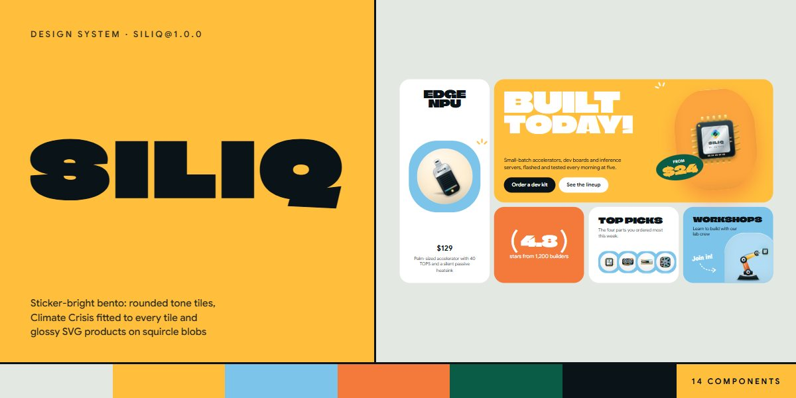

# Siliq · design system

`siliq@1.0.0` · 14 components · 44 tokens · light

A playful bento on a pale sage ground: rounded tiles in sky, honey, tangerine and white, Climate Crisis display type sized to fit each tile, handwritten Playpen Sans notes with dashed arrows, rotated leaf price stickers, three-stroke sparks, and glossy illustrated products sitting on squircle blobs. Buttons fill with a spinning blob on hover. Extracted from the Siliq AI Hardware Lab page.

The full board, every component at once: [preview.jpg](preview.jpg)

**Explore it live:** [instalanding.ai/systems/siliq](https://instalanding.ai/systems/siliq) — every component rendered, a token playground and COPY FOR AGENT.

## Files

| File | What it is |
| --- | --- |
| [`specimen.html`](specimen.html) | Every component live in one file. Each is a `<section data-component>`; the markup inside `.sp-demo` is the component. Opens from disk. |
| [`tokens.css`](tokens.css) | The design tokens as CSS custom properties (`--sq-*`). |
| [`siliq.css`](siliq.css) | Tokens plus every component's CSS, scoped under `.sq` with `sq-` class names, so it can't restyle anything else on your page. |

## Use it

1. Load the fonts: `<link rel="stylesheet" href="https://fonts.googleapis.com/css2?family=Climate+Crisis&family=Google+Sans:wght@400..700&family=Playpen+Sans:wght@600..800&display=swap">`
2. Link `siliq.css` and wrap the part of your page that uses the system in `
`.
3. Copy components from `specimen.html`. Interactive ones need the small script in its `<script id="sq-components-js">`, and any that draw SVG art need its `<svg id="sq-defs">`.
4. Change the look by editing the tokens, not the components.

## Components

- Navigation
- Buttons & links
- Bento hero board
- Statement & facts
- Product tiles
- Class schedule
- Timeline
- Picture bento
- Team cards
- Rating & reviews
- Pricing plans
- FAQ
- Contact & form
- Footer

## Conventions

**Typography**

- Display is Climate Crisis, uppercase, line-height .9. Big words use .sq-fit with --sq-len set to the character count, so they fill their tile's width (the tile needs container-type: inline-size; tune with --sq-fit-w and --sq-fit-max).
- Text is Google Sans 400-700; leads use --sq-lead in --sq-ink-soft. One handwritten note per area in Playpen Sans 700 (.sq-hand), rotated a few degrees, often with a dashed arrow.
- Prices on stickers and plans are Climate Crisis; small labels are Google Sans 600 uppercase with .06em tracking.

**Layout**

- Everything is a tile: radius --sq-r-tile, no borders, no shadows, on the --sq-ground background, separated by --sq-gap. Pages are bentos of tiles, not stacked sections.
- Tiles take one tone: .sq-tone-white, -sky, -honey or -tangerine set --sq-t-bg, --sq-t-blob and --sq-t-spark, and the picture blob and sparks follow the tile.
- Grids use auto-fill with minmax(min(100%, 230-330px), 1fr) and the hero board a named 4-column grid that drops to 2 columns under 1100px; product tiles turn into compact rows under 700px.

**Stickers & pictures**

- Products are glossy SVG symbols from <svg id="sq-defs"> (<use href="#sq-i-chip">, -gpu, -board, -stick, -fan, -ram, -rack …) in a .sq-pic disc on a squircle .sq-blob (border-radius --sq-r-blob) inside .sq-art.
- Prices go on .sq-sticker: a leaf oval rotated -8deg with honey Climate Crisis numerals. Decorate with .sq-sparks (three short strokes) at a tile corner.
- The only floating chrome is the white nav pills with --sq-shadow-float; everything else is flat colour.

**Motion**

- Buttons fill with a rotating blob rising from below on hover (--sq-dur-pop, --sq-ease-pop); icon buttons jelly; links turn into marching dashes.
- The pricing switch knob springs on --sq-ease-pop; FAQ answers open on their natural height; the review marquee loops over --sq-dur-marquee and pauses on hover or focus.
- Illustrations carry small loops (blinking LEDs, spinning fans, travelling traces); prefers-reduced-motion stops every animation and transition, and the marquee becomes a scrollable row.

**Accessibility**

- Meaningful pictures are role="img" with an aria-label; sparks, blobs and the marquee copy are aria-hidden.
- The menu button has aria-expanded and swaps its label; the pricing switch is role="switch" with aria-checked; the FAQ is native details/summary.
- Focus is a 3px leaf outline offset 3px; white text only sits on honey, tangerine, sky and leaf tiles at display sizes.

## Extracted from

- [Siliq AI Hardware Lab Page](../../pages/siliq-ai-hardware-lab-page) · [live](https://instalanding.ai/demos/siliq-lab.html)

Every system is extracted from a real, working page: the components are its markup, not a redraw.

MIT.
