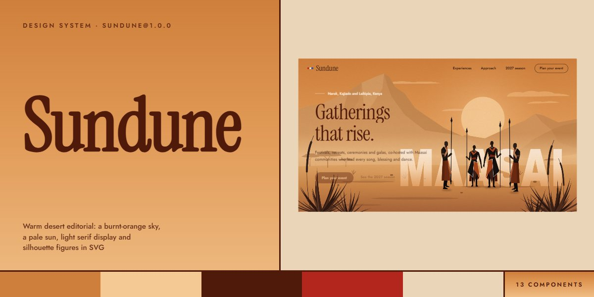

# Sundune · design system

`sundune@1.0.0` · 13 components · 82 tokens · light

A warm, earthy editorial language for events, travel, hospitality and culture: a burnt-orange to apricot sky (--sd-sky-1 to --sd-sky-3) over a pale sun disc, Instrument Serif set large and light ("Gatherings that rise."), Jost for copy and for small kickers that follow a 42px rule, dark umber pills beside text links underlined with a 1.5px wipe, and a giant Archivo Black word knocked out of the sky behind silhouette figures, ridges, acacias, a flock and reeds, all drawn in SVG. Shuka-red bands carry a texture cut from the figures' own cloth folds; beads count places, fill shares and draw a collar, every one placed by code; ruled rows, sticky art frames and spear-tipped rules keep it editorial. Motion is slow and warm: lines rise out of masks, the sun breathes, clouds drift, and the figures leap on a tap. Extracted from the Sundune event page, whose hero recreates the "Maasai-Inspired Event Hero Banner Concept" from the Rive Marketplace in plain SVG and CSS.

The full board, every component at once: [preview.jpg](preview.jpg)

**Explore it live:** [instalanding.ai/systems/sundune](https://instalanding.ai/systems/sundune) — every component rendered, a token playground and COPY FOR AGENT.

## Files

| File | What it is |
| --- | --- |
| [`specimen.html`](specimen.html) | Every component live in one file. Each is a `<section data-component>`; the markup inside `.sp-demo` is the component. Opens from disk. |
| [`tokens.css`](tokens.css) | The design tokens as CSS custom properties (`--sd-*`). |
| [`sundune.css`](sundune.css) | Tokens plus every component's CSS, scoped under `.sd` with `sd-` class names, so it can't restyle anything else on your page. |

## Use it

1. Load the fonts: `<link rel="stylesheet" href="https://fonts.googleapis.com/css2?family=Archivo+Black&family=Instrument+Serif:ital@0;1&family=Jost:wght@400;500;600&display=swap">`
2. Link `sundune.css` and wrap the part of your page that uses the system in `
`.
3. Copy components from `specimen.html`. Interactive ones need the small script in its `<script id="sd-components-js">`, and any that draw SVG art need its `<svg id="sd-defs">`.
4. Change the look by editing the tokens, not the components.

## Components

- Header & menu sheet
- Buttons, links & chips
- Type, kickers & labels
- Desert sky hero
- Silhouette frieze
- Manifesto & principles
- Experience rows & art frame
- Ledger & spear rule
- Season dates
- Process steps
- Testimonial
- Enquiry form
- Footer & wordmark

## Conventions

**Typography**

- Instrument Serif (--sd-font-display) at weight 400 does all the talking, large and light: the hero display (.sd-hero-title, --sd-display, line-height .9, -.018em) with each line in .sd-lw > .sd-ln rising out of its mask, h2s at --sd-h2, the manifesto (.sd-scrub), ledger, row titles, quotes, dates, numerals, the logo and the footer wordmark. Never bold it.
- Jost (--sd-font-text) carries copy at --sd-text (17px/1.65) and every small piece at 500: buttons, links, kickers and labels. Body copy on sand is --sd-ink-soft; small titles in a row (.sd-what h3, .sd-principles h3, .sd-steps h3) are Jost 600.
- Kickers are sentence case, never tracked capitals: .sd-place is a dawn-white line after a 42px rule (on the sky); .sd-label is accent after a small V chevron (on sand). A section head is .sd-sec-head: a serif h2 left, a soft Jost paragraph right.
- Archivo Black (--sd-font-word) is only for the one giant knockout word behind the figures in the hero, set in SVG with textLength so it spans the stage.

**Colour & sky**

- The sky is the signature: a vertical gradient from --sd-sky-1 (burnt orange) through --sd-sky-2 to --sd-sky-3 (apricot), with a pale --sd-sun disc and its soft glow. Copy on the sky is --sd-umber (display, links) and --sd-bark (header, body); kickers on it are --sd-dawn.
- Below the sky the page is sand (--sd-bg) with ink text and --sd-line hairlines. --sd-accent picks out what matters: labels, the active row, ledger figures, numerals, short statuses and the wordmark.
- Shuka-red bands (--sd-red with --sd-red-ink text, --sd-red-soft for secondary copy, --sd-red-line for strokes) hold the frieze, the menu sheet and the enquiry form; each is textured with --sd-red-tex through the --sd-m-shuka mask, as in .sd-frieze::before.
- Beads use the three bead colours (--sd-bead-red, --sd-bead-blue, --sd-bead-orange) plus cream; the logo mark is three beads.

**Illustration & figures**

- Pictures are SVG, never photos: the figures (#sd-w-front, #sd-w-side), bird, reed and acacia are <symbol>s in <svg id="sd-defs">, with the art's patterns, gradients and filters (sd-gLeather, sd-pCheck, sd-fBead, sd-linen ...). Copy #sd-defs once per page; draw a figure with <svg viewBox="0 0 105 610"><use href="#sd-w-side"/></svg> (or 0 0 250 865 for #sd-w-front), mirror it by flipping the inner svg (.sd-flip).
- The hero stage is a fixed 1672x940 composition: every layer (.sd-layer with data-sd-depth for parallax) is placed in % of that box and the stage covers the hero from the bottom. Keep new parts in %, never px.
- Textures are cut from the figures' own shapes and ship as mask tokens: --sd-m-shuka (cloth folds), --sd-m-spear (the spear, for .sd-spears), --sd-m-collar (beaded V's, for .sd-collar) and --sd-img-shuka (the footer wordmark fill).
- The page depicts Maasai figures and credits the Rive Marketplace concept its hero recreates; keep that credit wherever the hero ships. When reusing the system for something else, swap the giant word and the figures for your own subject rather than using a community's name or dress as decoration, and keep copy about people led by them (as the page's own copy is).
- Bead art (the collar, bangles, gala table, season strands) is generated by the component script from data attributes (data-sd-collar="cx,cy", data-sd-bangles, data-sd-gala, data-sd-clump); strands are twelve <i> with .sd-f on the filled ones.

**Buttons & forms**

- The primary is .sd-btn.sd-btn-hero: an umber pill (--sd-pill) with cream Jost 500 that deepens to bark and lifts 2px. Pair it with .sd-link-u, a text link whose 1.5px underline wipes away to the right on hover. On red, use .sd-btn.sd-btn-light.
- Quieter actions are outlined pills: .sd-pill (1.5px currentColor, fills on hover) in the header, .sd-btn-sm (1.5px --sd-line-strong, fills ink) in rows.
- Forms sit on the red band: radio .sd-chip pills (checked fills cream), a range with a serif <output> readout, and .sd-line-input fields that are just a 1.5px underline turning cream on focus. Validate inline into .sd-form-msg (role="status"); the demo form sends nothing.

**Motion**

- Everything eases on --sd-ease. Load-in is slow and warm: display lines rise over --sd-dur-line-in, the kicker, lede and buttons fade up over --sd-dur-fade-in with small staggers, the giant word rises over --sd-dur-rise.
- The scene loops gently: the sun breathes on --sd-dur-sun, clouds drift on --sd-dur-cloud, the flock crosses on --sd-dur-flock, reeds and grass sway. The hero pauses its loops off screen (.sd-paused).
- The figures leap on Web Animations (the page's own crouch, spring, hang and land keyframes): each hero figure is a button, the four leap left to right once when the hero first shows, the frieze leaps in a wave as you scroll and the enquiry figure leaps when the form is sent.
- In view: process rules draw out over --sd-dur-draw and grow a tip, share beads fill over --sd-dur-bead, ledger figures count up, the active experience's art fades in over --sd-dur-art and settles over --sd-dur-zoom. Under prefers-reduced-motion the loops and the drift stop, the manifesto lights at once and only a press plays a leap.

**Accessibility**

- Scenery is aria-hidden; each hero figure is a real <button> with an aria-label. Bead strands are role="img" with an aria-label giving places taken; the share row says its percentage the same way.
- Focus is a 2px currentColor outline offset 4px (--sd-r-focus); on the sky the figures use --sd-halo. The menu sheet is a dialog: Close takes focus when it opens, Escape or a link closes it and focus returns to the Menu button.
- Copy on the sky stays umber or bark (dark on light); on red, --sd-red-ink. The manifesto keeps its full text in the DOM; words only dim once the script has split them.

## Extracted from

- [Maasai-Inspired Event Landing Page](../../pages/maasai-inspired-event-landing-page) · [live](https://instalanding.ai/demos/maasai-event-hero.html)

Every system is extracted from a real, working page: the components are its markup, not a redraw.

MIT.
