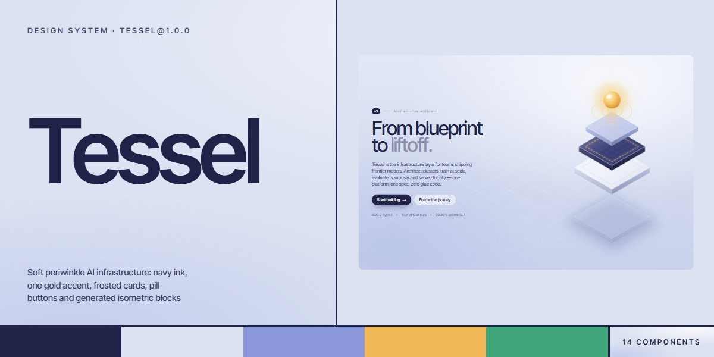

# Tessel · design system

`tessel@1.0.0` · 14 components · 71 tokens · light

A soft, precise language for AI infrastructure, developer platforms and cloud products: a periwinkle sky over an isometric diamond grid, navy ink in three steps, one gold accent for the thing to press, green kept for live states, frosted white cards with long navy shadows and pill buttons in Inter Tight. Every illustration is generated isometric SVG (blocks lit on three faces, a server-grid scene, a floating stack under a gold orb) with a pixel-art guide as narrator; specs, deploy logs, sparklines, eval bars and region rows read like a live console. Extracted from the Tessel AI Infrastructure page.

The full board, every component at once: [preview.jpg](preview.jpg)

**Explore it live:** [instalanding.ai/systems/tessel](https://instalanding.ai/systems/tessel) — every component rendered, a token playground and COPY FOR AGENT.

## Files

| File | What it is |
| --- | --- |
| [`specimen.html`](specimen.html) | Every component live in one file. Each is a `<section data-component>`; the markup inside `.sp-demo` is the component. Opens from disk. |
| [`tokens.css`](tokens.css) | The design tokens as CSS custom properties (`--ts-*`). |
| [`tessel.css`](tessel.css) | Tokens plus every component's CSS, scoped under `.ts` with `ts-` class names, so it can't restyle anything else on your page. |

## Use it

1. Load the fonts: `<link rel="stylesheet" href="https://fonts.googleapis.com/css2?family=Inter+Tight:wght@400;450;500;600&display=swap">`
2. Link `tessel.css` and wrap the part of your page that uses the system in `
`.
3. Copy components from `specimen.html`. Interactive ones need the small script in its `<script id="ts-components-js">`, and any that draw SVG art need its `<svg id="ts-defs">`.
4. Change the look by editing the tokens, not the components.

## Components

- Navigation
- Buttons
- Isometric hero
- Eyebrows & chips
- Isometric blocks
- Pixel guide
- Spec panel
- Terminal
- Utilisation panel
- Eval bars
- Region rows
- Chapter rail
- Signup
- Closing band & footer

## Conventions

**Typography**

- One family: Inter Tight. Headlines are weight 500 with tight tracking (-.045em to -.05em) and line-height .86-.88 (--ts-display, --ts-title, --ts-closing); the last words of a headline sit in <em> and fade to --ts-ink-muted (45% white on the night band), never italic.
- Body is Inter Tight 450 with -.005em tracking; leads are --ts-lead at line-height 1.42 in --ts-ink2. Labels, panel headers and meta lines are --ts-caption / --ts-micro in --ts-ink-muted or --ts-muted. Figures are tabular.
- Code and terminal lines use --ts-font-code on the navy --ts-code-bg: keys --ts-code-key, values --ts-code-str, comments --ts-code-dim, checks --ts-code-ok.

**Color**

- The ground is the periwinkle sky (.ts-surface: --ts-sky with the isometric diamond grid --ts-grid masked to the middle). Text is navy ink in three steps: --ts-ink, --ts-ink2, --ts-muted.
- Gold (--ts-gold to --ts-gold2) is the one accent: the gold button (one per view), chip diamonds, sparklines, the candidate's eval bar, the rail's progress line and the orb in the drawings. Periwinkle (--ts-peri) is the quiet second series.
- Green (--ts-ok) only means live or passing: the pinging live dot, region LEDs and gate lines. The page closes on the navy night band (.ts-band, --ts-night) where the line button turns outline-white.

**Layout & shapes**

- Cards are frosted (.ts-panel: --ts-card, a --ts-frost-edge hairline, --ts-glass blur, --ts-shadow-panel, --ts-r-panel) with a .ts-panel-h header that pairs a label with a value or a live dot. Stat tiles use --ts-r-card; code blocks --ts-r-code.
- Every button, chip, field, nav link group and rail is a pill (--ts-r-pill). Buttons: .ts-btn plus .ts-btn-dark (default), .ts-btn-gold (the one call to action), .ts-btn-line or .ts-btn-ghost; the arrow (.ts-arr) slides on hover.
- Illustrations are generated isometric SVG, never images: blocks with three lit faces from the four ramps (navy, white, periwinkle, gold), a white specular edge and a contact shadow, drawing from the shared <svg id="ts-defs"> gradients and filters. The pixel guide is the narrator, one per page.

**Motion**

- Hover lifts buttons 1px over --ts-dur on --ts-ease (cubic-bezier(.22,1,.36,1)); code lines slide in one after another (--ts-dur-type) and eval bars grow over --ts-dur-bar.
- Live widgets tick every 0.9s while on screen: the sparkline drifts, region latencies and loads jitter, the live dot pings over --ts-dur-live. Drawings bob, pulse and flow on slow loops; the guide walks on four frames.
- With prefers-reduced-motion every loop stops and every component is complete: bars at their values, all lines shown.

**Accessibility**

- Drawings are inline SVG with role="img" and an aria-label; decorative dots, diamonds and the sparkline are aria-hidden.
- The rail is a tablist of real buttons whose current one carries aria-selected; the signup input has an aria-label and uses native email validation before the green thank-you line replaces it.
- Body text stays at --ts-ink2 or darker on the sky; --ts-ink-muted is for labels and headline fades only.

## Extracted from

- [Tessel AI Infrastructure Page](../../pages/tessel-ai-infrastructure-page) · [live](https://instalanding.ai/demos/tessel-ai-infrastructure.html)

Every system is extracted from a real, working page: the components are its markup, not a redraw.

MIT.
