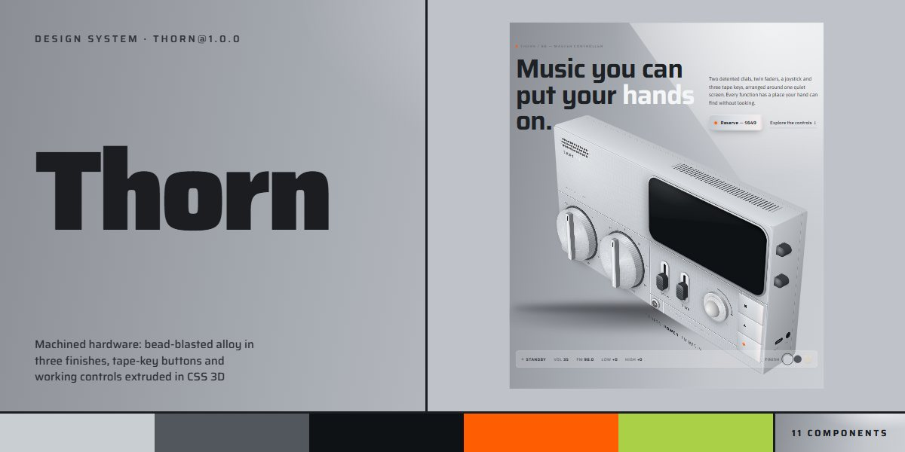

# Thorn · design system

`thorn@1.0.0` · 11 components · 83 tokens · light

Bead-blasted alloy in Fog, Graphite and Sand, tape-key buttons with a record-light dot, Saira set tight over Asap, lime for power and signal orange for record, and a whole device built from stacked layers in CSS 3D whose dials, faders, joystick, tape keys and toggles really work. Extracted from the Thorn Music Controller page.

The full board, every component at once: [preview.jpg](preview.jpg)

**Explore it live:** [instalanding.ai/systems/thorn](https://instalanding.ai/systems/thorn) — every component rendered, a token playground and COPY FOR AGENT.

## Files

| File | What it is |
| --- | --- |
| [`specimen.html`](specimen.html) | Every component live in one file. Each is a `<section data-component>`; the markup inside `.sp-demo` is the component. Opens from disk. |
| [`tokens.css`](tokens.css) | The design tokens as CSS custom properties (`--th-*`). |
| [`thorn.css`](thorn.css) | Tokens plus every component's CSS, scoped under `.th` with `th-` class names, so it can't restyle anything else on your page. |

## Use it

1. Load the fonts: `<link rel="stylesheet" href="https://fonts.googleapis.com/css2?family=Saira:wght@100..900&family=Asap:wght@100..900&display=swap">`
2. Link `thorn.css` and wrap the part of your page that uses the system in `
`.
3. Copy components from `specimen.html`. Interactive ones need the small script in its `<script id="th-components-js">`, and any that draw SVG art need its `<svg id="th-defs">`.
4. Change the look by editing the tokens, not the components.

## Components

- Navigation
- Controller hero
- Tape-key buttons
- Headline pairing
- Control tiles
- Display
- Finish cards
- Accent cards
- Specifications
- Reservation
- Footer

## Conventions

**Typography**

- Saira does display and labels: headlines at weight 620-640 with -0.025em tracking and line-height .98 (--th-display, --th-display-lg, --th-display-xl); one word in a headline can go white (<em>) on the alloy.
- Kickers and readouts are Saira 500-550 at 12-13px, uppercase, tracked .08-.18em, in --th-ink-3; a kicker leads with a 6px signal-orange dot. Numbers use tabular figures.
- Body is Asap 15-19px at line-height 1.5 in --th-ink-2; ledes stop at 34em.

**Layout**

- Content sits in .th-wrap (1240px, 20px gutters) with --th-section-y of space; section heads are two columns (kicker and headline left, lede right) that stack under 860px.
- Bento tiles sit three across on an 18px gap (two under 980px, one under 640px); a tile holds one live control centred on a stage, a value readout top right and numbered copy below.
- Sections change ground by tone, not by line: alloy greys, one carbon section for the screen and a lighter radial glow for the finale.

**Hardware**

- Inside a device or a .th-kit, 1em is one design unit (font-size: var(--th-u)); scale a device by setting --th-u, never by transform.
- Depth is stacked layers: the builders extrude every part with stack(class, z0, z1, n) at increasing translateZ inside a .th-scene; the scene tilts toward the cursor (data-th-rx, -ry, -amp) and moves the sheen.
- Hosts are empty elements: data-th-c="device" (add data-th-hint for the PRESS POWER line), "dials", "faders", "joy", "keys", "power" or "screen" inside a .th-kit.th-rig in a .th-scene; the script fills them.
- State lives on the nearest [data-th-unit] or .th root as data-th-power, -playing, -rec, -mode, -shuffle and -loop; style from those attributes. data-th-finish (fog, graphite, sand) re-finishes everything inside, and any element can pin its own.
- Lime means power and signal orange means record, in every finish; nothing else glows.

**Motion**

- Presses are quick (--th-dur-press with --th-ease); keys sink when latched, buttons lift 1px on hover and press in on :active; swatches and toggles spring (--th-spring).
- Ambient motion is the device's own: the breathing screen glow (--th-dur-breathe), the blinking record light (--th-dur-blink), the power-key pulse (--th-dur-pulse) and the tilt.
- prefers-reduced-motion turns off the tilt and every animation, and transitions become instant.

**Accessibility**

- Dials and faders are role="slider" with arrow and Page keys; the joystick is a button (Enter or Space plays, left and right change mode); keys, toggles and the power key are buttons with aria-pressed where they latch.
- Clicks are synthesized with Web Audio only after a user gesture, and the sound toggle (data-th-sound) turns them off.
- Mini devices used as pictures are aria-hidden and out of the tab order; focus is a 2px signal-orange ring.

## Extracted from

- [Thorn Music Controller Page](../../pages/thorn-music-controller-page) · [live](https://instalanding.ai/demos/thorn-controller.html)

Every system is extracted from a real, working page: the components are its markup, not a redraw.

MIT.
