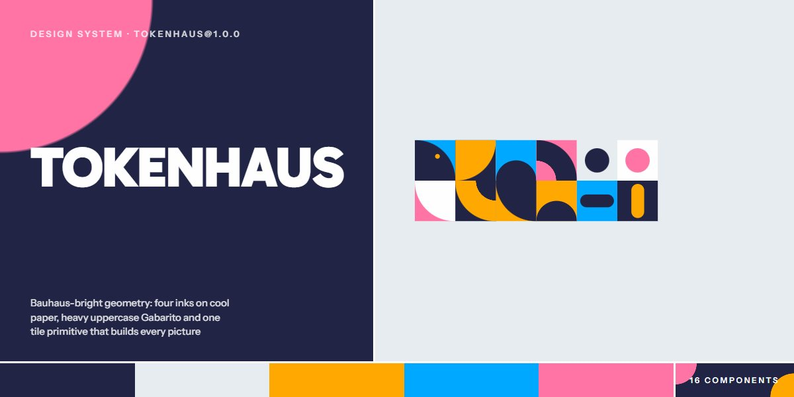

# Tokenhaus · design system

`tokenhaus@1.0.0` · 16 components · 41 tokens · light

A Bauhaus-bright language for education, design tools, creative studios and playful developer products: ink, amber, sky and pink on cool grey paper, Gabarito set heavy and uppercase, and Instrument Sans for reading. Every picture starts from one primitive, a square tile holding a quarter-round, half disc, quarter ring, dot or pill turned in quarter steps, which builds the wordmark, the hero board, mosaics, clusters and the big quarter-round corners cut from cards. Pills grow a pink circle from their corner on hover, links run a 3px pill underline out and back, outlined words carry stacked echoes in the four inks, and courses open as full-width pill accordions. Portraits, swatch fans, glyph keys and specimen cards are drawn in code as SVG. Extracted from the tokenhaus AI Design System Academy page.

The full board, every component at once: [preview.jpg](preview.jpg)

**Explore it live:** [instalanding.ai/systems/tokenhaus](https://instalanding.ai/systems/tokenhaus) — every component rendered, a token playground and COPY FOR AGENT.

## Files

| File | What it is |
| --- | --- |
| [`specimen.html`](specimen.html) | Every component live in one file. Each is a `<section data-component>`; the markup inside `.sp-demo` is the component. Opens from disk. |
| [`tokens.css`](tokens.css) | The design tokens as CSS custom properties (`--tk-*`). |
| [`tokenhaus.css`](tokenhaus.css) | Tokens plus every component's CSS, scoped under `.tk` with `tk-` class names, so it can't restyle anything else on your page. |

## Use it

1. Load the fonts: `<link rel="stylesheet" href="https://fonts.googleapis.com/css2?family=Gabarito:wght@600..900&family=Instrument+Sans:wght@400..600&display=swap">`
2. Link `tokenhaus.css` and wrap the part of your page that uses the system in `
`.
3. Copy components from `specimen.html`. Interactive ones need the small script in its `<script id="tk-components-js">`, and any that draw SVG art need its `<svg id="tk-defs">`.
4. Change the look by editing the tokens, not the components.

## Components

- Header
- Buttons & links
- Geometric tiles
- Type & echo
- Tile hero
- Statement & principles
- Pill accordion
- Tile mosaic
- Rail steps
- Halftone portraits
- Stat tiles & bars
- Quote cards
- Fee cards
- FAQ
- Contact
- Footer & ink bar

## Conventions

**Typography**

- Display is Gabarito, heavy and uppercase: .tk-h2 at 900, --tk-display, line-height .9, -.015em; step titles and figures 900; h3s (.tk-h3) 800 in sentence case; statements, quotes and the about line 700. Body and leads are Instrument Sans 400 (--tk-text, --tk-lead); labels 600.
- Words that fill their container use .tk-fit inside a .tk-fill (container-type: inline-size) parent, with style="--tk-len:N" (the letter count) and an optional --tk-cap; the size is min(cap, 100cqw / (len × --tk-k)). Figures (.tk-nu-fig, .tk-fe-num) and the hero's ACADEMY use the same formula.
- An outlined word with stacked copies: data-tk-echo="n" on the word, --tk-eb set to the ground colour (the outline is a text-shadow in it) and --tk-eg for the step. Add data-tk-echo-inks to colour the copies pink, amber, light, ink. The component script writes the copies.

**Color & composition**

- Four inks on paper: --tk-ink, --tk-amber, --tk-sky and --tk-pink on --tk-paper, with --tk-light for cards and highlights. Sections are flat colour fields (amber courses and FAQ, sky manifesto and quotes, pink process, ink tutors and contact); never gradients.
- Text is ink on amber, sky, pink, paper and light; light on ink. Secondary text uses the oklab mixes --tk-soft-on-paper, --tk-faint-on-paper, --tk-soft-on-ink and --tk-dim-on-ink; never new greys. On ink panels, buttons switch to amber (--tk-bf: amber, --tk-bt: ink).
- Layouts sit on a 12-column grid in a --tk-wrap column with --tk-side gutters and --tk-pad section padding: heads take columns 1-8 with the lead at 9-12; sticky heads take 1-5 beside lists at 7-12.

**Shapes & pictures**

- The tile is the only picture primitive: <i class="tk-t tk-q|tk-h|tk-ring|tk-dot|tk-bar" style="--tk-tb:var(--tk-ink);--tk-tf:var(--tk-amber);--tk-r:1"><b></b></i>. --tk-tb is the ground, --tk-tf the shape, --tk-r its quarter turns. Give it a size or aspect-ratio: 1.
- Corners are either square or one huge quarter-round (--tk-rq) on a single corner of a card, picture or stat tile; pills (--tk-pill) are for buttons, time chips, bars, course rows and bullets. Nothing has a small radius.
- Rules are 3px ink (--tk-rule): principle rows, FAQ rows. There are no shadows on UI; only the coded artwork casts soft drop shadows.
- Pictures are SVG drawn in code: <svg class="tk-art" data-tk-art="fan|wall|poster|paper|curves|typecase|roller|marta|jonas|aiyana|karim" viewBox=…> painted by the component script with the inks as tk-i, tk-a, tk-s, tk-p, tk-l and tk-g classes. Never use image files.

**Motion**

- Everything eases on --tk-ease (cubic-bezier(.7,0,.2,1)), a hard in-out. Buttons grow a --tk-bh circle from their bottom-left over --tk-dur-wipe while the text turns --tk-bht; link underlines shrink to the right and regrow from the left over --tk-dur-run; plus buttons turn a quarter over --tk-dur-turn; accordion plus bars rotate over --tk-dur.
- The page's scroll choreography (tiles turning, pills shrinking to dots, echoes fanning out, a rolling disc, stacked quote cards) is not part of the system; every component is complete at rest.
- Under prefers-reduced-motion every transition and animation is switched off.

**Accessibility**

- Tiles, pills, shapes and echo copies are aria-hidden; artwork SVGs carry role="img" and an aria-label.
- Course and FAQ rows are <button aria-expanded> over a panel with hidden, toggled together with .tk-is-open on the item. The burger has aria-controls, aria-expanded and a label that swaps between data-tk-label-open and data-tk-label-close; Escape closes the menu.
- Focus shows a 3px sky outline (--tk-focus) offset 3px. Body text stays ink on the light fields and light on ink.

## Extracted from

- [tokenhaus AI Design System Academy Page](../../pages/tokenhaus-ai-design-system-academy-page) · [live](https://instalanding.ai/demos/tokenhaus-design-academy.html)

Every system is extracted from a real, working page: the components are its markup, not a redraw.

MIT.
