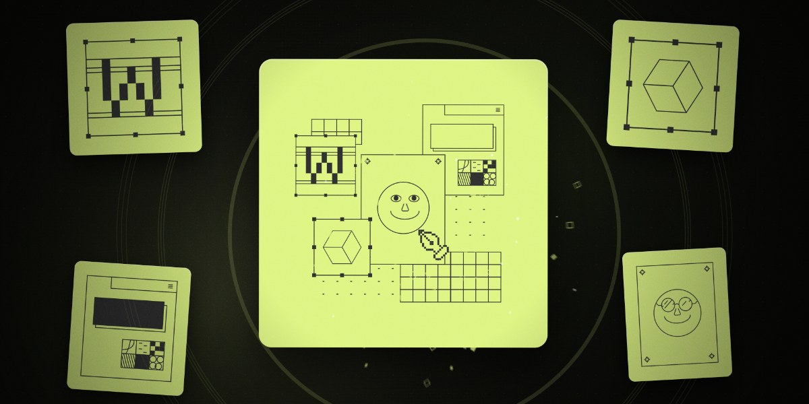

# Brand Identity · video

0:15 · Decoded Rive · Canvas 2D · soundtrack · one HTML file

A 15-second wordless brand reel: lime cards for type, palette, a cube, a face and a grid pop, flip and shatter under a moving camera, then gather into one identity board with its pieces in orbit.

**Watch it:** [instalanding.ai/videos/brand-identity](https://instalanding.ai/videos/brand-identity) — or open `index.html` from disk. Every frame renders live in the browser; there is no video file. Press play inside it (browsers only start sound after a click).

## Files

| File | What it is |
| --- | --- |
| [`index.html`](index.html) | The video: one file with its models, images and sound inlined. |

## Tags

brand, camera moves, motion blur, sound.
