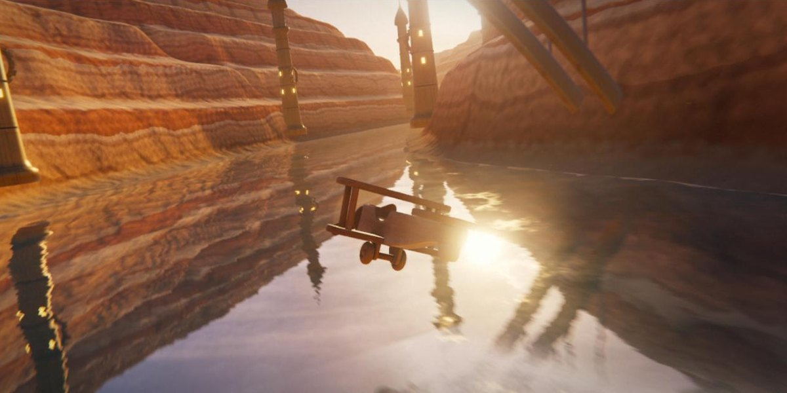

# Canyon Run · video

0:15 · Real-time 3D · generated score · one HTML file

A 15-second real-time video: a wooden biplane flies through a sunset canyon that turns into code, with the canyon, sky, light and score all generated in the browser.

**Watch it:** [instalanding.ai/videos/canyon-run](https://instalanding.ai/videos/canyon-run) — or open `index.html` from disk. Every frame renders live in the browser; there is no video file. Press play inside it (browsers only start sound after a click).

## Files

| File | What it is |
| --- | --- |
| [`index.html`](index.html) | The video: one file with its models, images and sound inlined. |

## Tags

real-time, 3d, procedural, sound.

## Built on

- Plane: “Basic Plane” by Blender3D, CC BY 4.0
