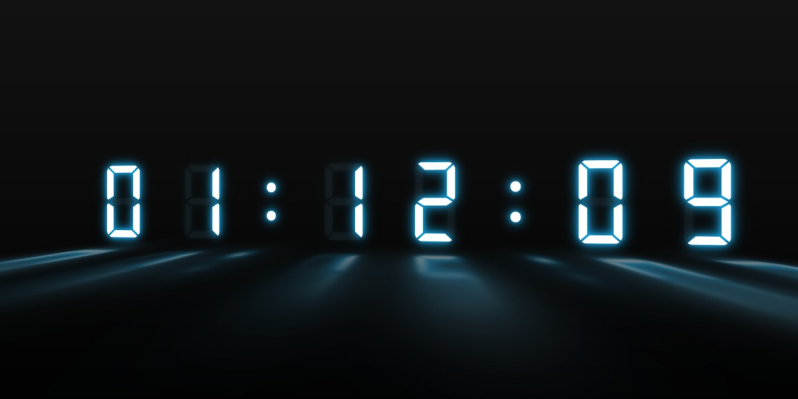

# Chaotic Time Clock · video

0:08 · CSS 3D · GSAP timeline · one HTML file

An 8-second shot of a glowing seven-segment clock floating over its own reflection, where time has come loose: the digits whir, surge and stutter as the clock races ahead, the camera drifts and the neon cycles through the spectrum.

**Watch it:** [instalanding.ai/videos/chaotic-time-clock](https://instalanding.ai/videos/chaotic-time-clock) — or open `index.html` from disk. Every frame renders live in the browser; there is no video file. It starts as soon as it opens and has no sound; a Replay button appears at the end.

## Files

| File | What it is |
| --- | --- |
| [`index.html`](index.html) | The video: one file with everything inlined. |

## Tags

clock, neon, css 3d, dark.
