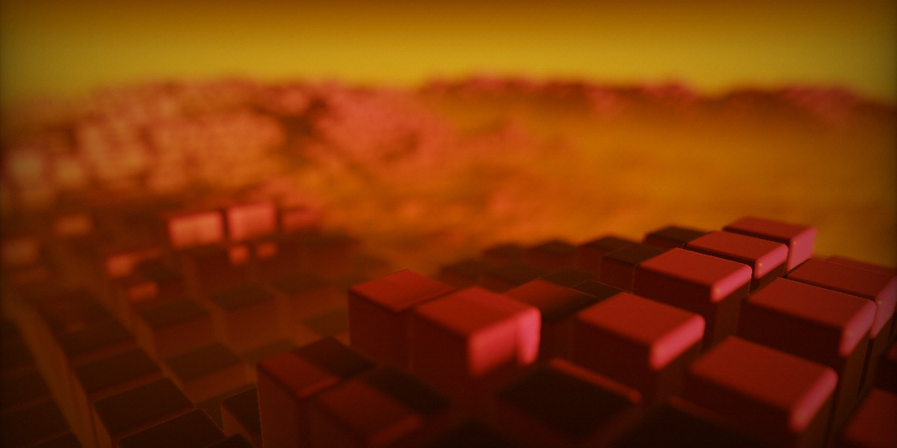

# Clay Cube Terrain · video

0:15 · WebGL2 · raymarched terrain · GSAP timeline · one HTML file

A 15-second drift over an endless field of rounded clay blocks rising and falling, raymarched in a single shader with fog, soft shadows and shallow depth of field, crossfading every three seconds through ember, porcelain, bioluminescent night, steel and molten-magma looks.

**Watch it:** [instalanding.ai/videos/clay-cube-terrain](https://instalanding.ai/videos/clay-cube-terrain) — or open `index.html` from disk. Every frame renders live in the browser; there is no video file. It starts as soon as it opens and has no sound; a Replay button appears at the end.

## Files

| File | What it is |
| --- | --- |
| [`index.html`](index.html) | The video: one file with everything inlined. |

## Tags

shader, terrain, generative, background.
