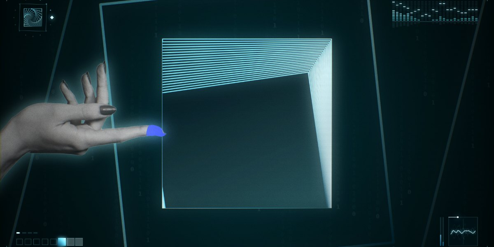

# Geometry Madness · video

0:14 · Decoded Rive · Canvas 2D · soundtrack · one HTML file

A 14-second beat-synced piece: a hand reaches in and taps a glowing square, which twists into a spiral tunnel, multiplies into a grid and shatters into prismatic light, cut to the soundtrack with a live HUD of spectrum, oscilloscope and binary beat counter.

**Watch it:** [instalanding.ai/videos/geometry-madness](https://instalanding.ai/videos/geometry-madness) — or open `index.html` from disk. Every frame renders live in the browser; there is no video file. Press play inside it (browsers only start sound after a click).

## Files

| File | What it is |
| --- | --- |
| [`index.html`](index.html) | The video: one file with its models, images and sound inlined. |

## Tags

beat-synced, geometric, rive, sound.
