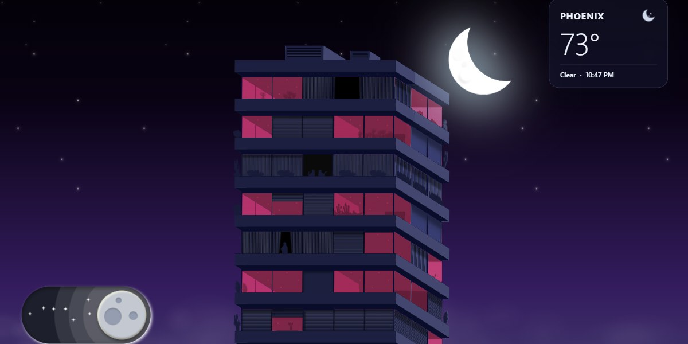

# Iso City Day & Night · video

0:11 · CSS 3D · GSAP timeline · one HTML file

An 11-second day-to-night cycle on an isometric apartment tower built in CSS 3D: a sun-and-moon toggle flips, the sun sets as a crescent moon and stars rise, hundreds of windows warm from blue to magenta, and a frosted weather card swaps Sunny 98° for Clear 73° before it all turns back to day.

**Watch it:** [instalanding.ai/videos/iso-city-day-night](https://instalanding.ai/videos/iso-city-day-night) — or open `index.html` from disk. Every frame renders live in the browser; there is no video file. It starts as soon as it opens and has no sound; a Replay button appears at the end.

## Files

| File | What it is |
| --- | --- |
| [`index.html`](index.html) | The video: one file with everything inlined. |

## Tags

isometric, css 3d, day and night, weather.
