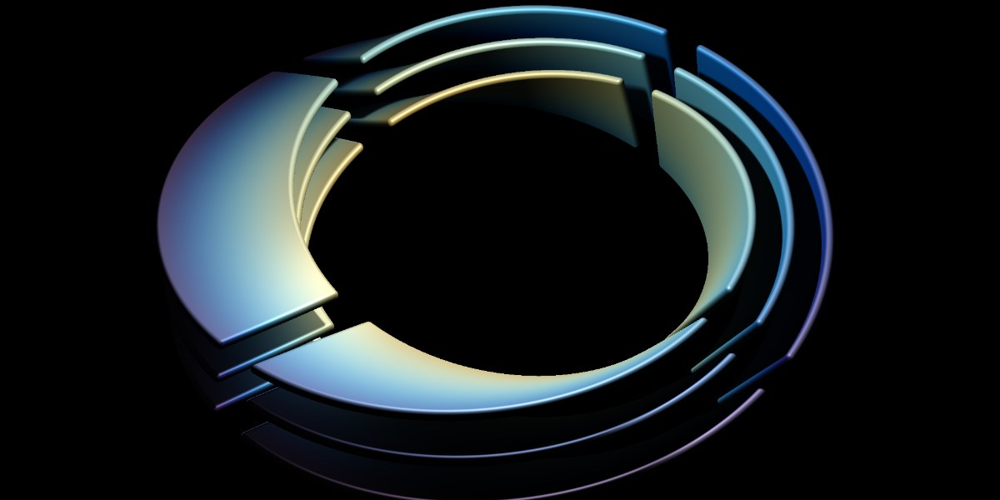

# Mobius Knot · video

0:13 · WebGL2 · one fragment shader · GSAP timeline · one HTML file

A 13-second loop on black: a twisting Möbius ribbon tied into a knot turns slowly in a raymarched shader, its layered bands catching soft shadows and an iridescent sweep of blue, gold and violet.

**Watch it:** [instalanding.ai/videos/mobius-knot](https://instalanding.ai/videos/mobius-knot) — or open `index.html` from disk. Every frame renders live in the browser; there is no video file. It starts as soon as it opens and has no sound; a Replay button appears at the end.

## Files

| File | What it is |
| --- | --- |
| [`index.html`](index.html) | The video: one file with everything inlined. |

## Tags

shader, raymarching, loop, dark.
