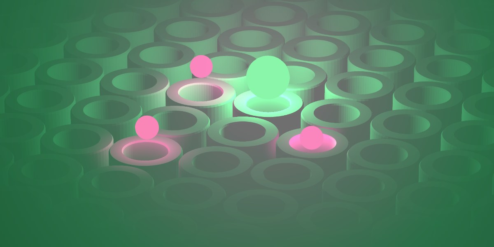

# Tube Field Lights · video

0:14 · three.js · point lights · GSAP timeline · one HTML file

A 14-second WebGL piece on black: pink light balls bounce up and down through a dark grid of rounded-square tubes, then a green ball rises, freezes mid-air, and blooms until its light engulfs the frame before pulling back into a single glowing orb.

**Watch it:** [instalanding.ai/videos/tube-field-lights](https://instalanding.ai/videos/tube-field-lights) — or open `index.html` from disk. Every frame renders live in the browser; there is no video file. It starts as soon as it opens and has no sound; a Replay button appears at the end.

## Files

| File | What it is |
| --- | --- |
| [`index.html`](index.html) | The video: one file with everything inlined. |

## Tags

webgl, lights, generative, dark.
