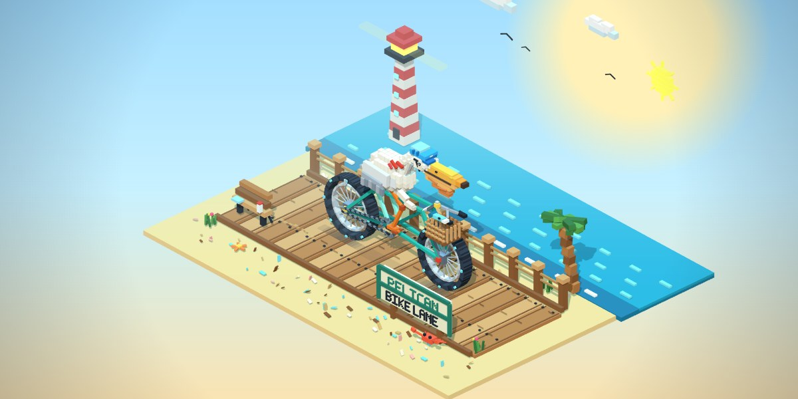

# Voxel Pelican Assembly · video

0:24 · three.js · voxels · GSAP timeline · one HTML file

A 24-second voxel build-and-ride: a seaside diorama of a pelican on a bicycle assembles itself block by block in an isometric view, then the camera flattens to a side-on shot and the pelican pedals off across a bridge that builds itself just ahead of the wheels.

**Watch it:** [instalanding.ai/videos/voxel-pelican-assembly](https://instalanding.ai/videos/voxel-pelican-assembly) — or open `index.html` from disk. Every frame renders live in the browser; there is no video file. It starts as soon as it opens and has no sound; a Replay button appears at the end.

## Files

| File | What it is |
| --- | --- |
| [`index.html`](index.html) | The video: one file with everything inlined. |

## Tags

voxel, 3d, isometric, camera moves.
